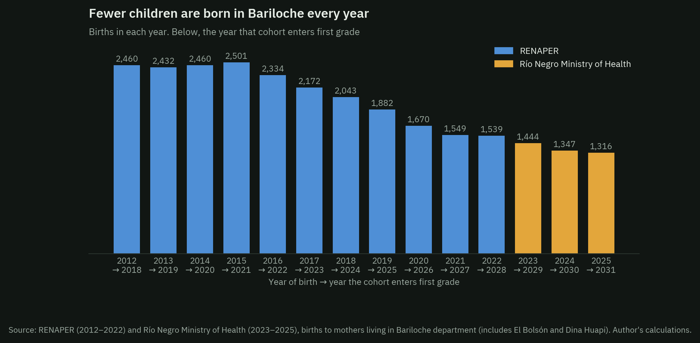
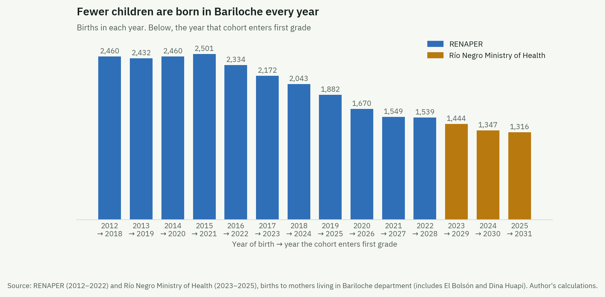
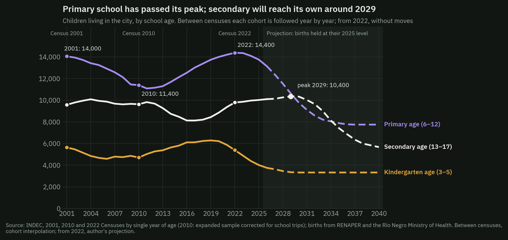
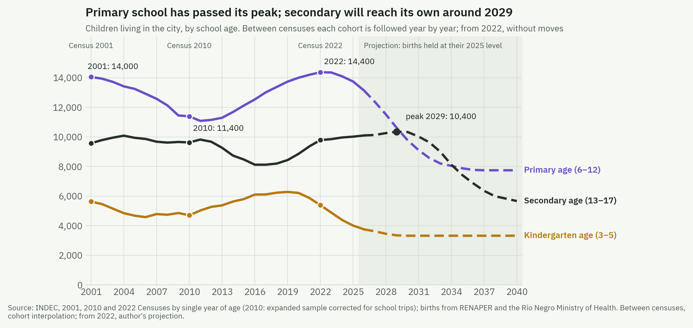
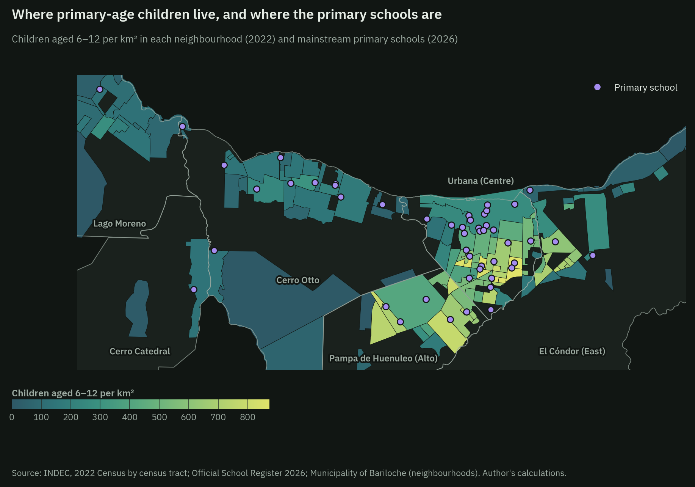
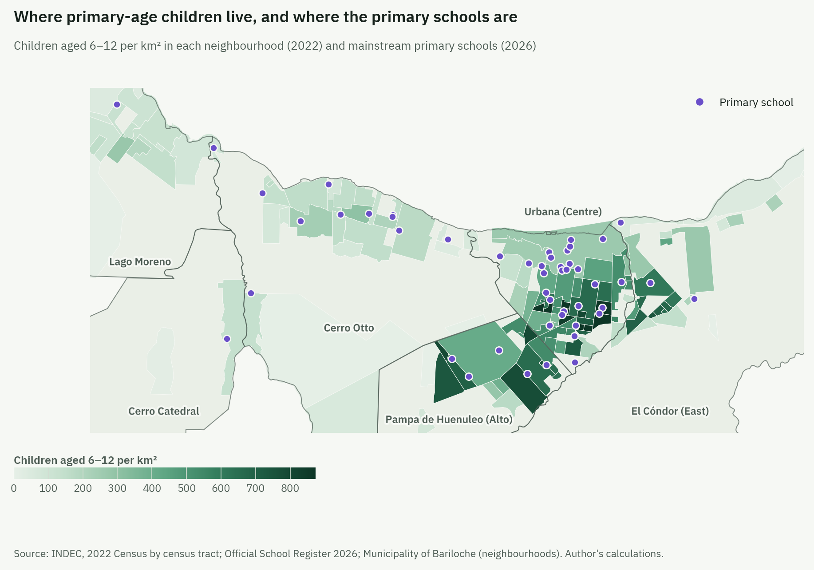
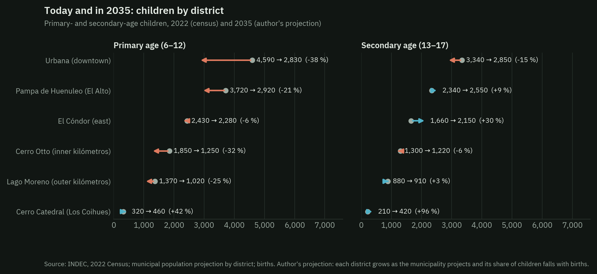
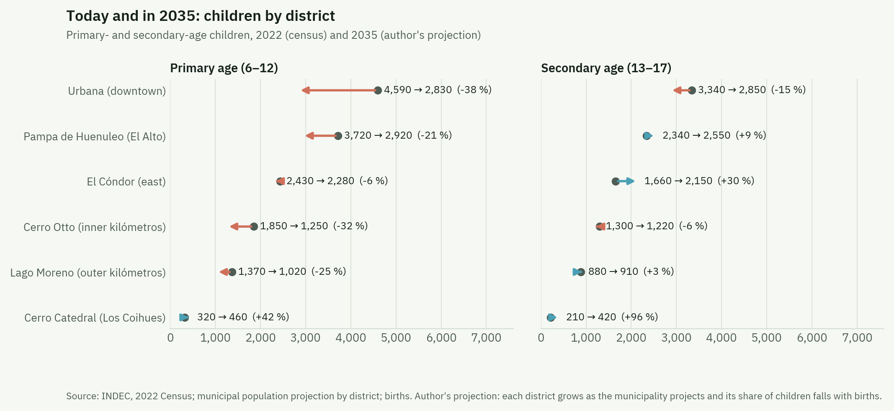

This is my first column for Bariloche2000, so let me introduce myself. I am Matías, born and raised in Bariloche. I went
to school at the Colegio Integral Vuriloche and the Instituto Dante Alighieri, studied Economics at the University of
Buenos Aires and later did my PhD in England. I have lived in Europe for seven years and now teach at Utrecht University,
in the Netherlands.

Ever since I left, I have had a habit I cannot break. Whenever something abroad catches my attention, I ask myself how
it would play out in Bariloche. This column grew out of that habit. I am not looking for recipes to import. Bariloche has
qualities no other city has, and some of its problems are entirely its own. But seeing how other places have handled
similar challenges, successfully or not, helps us think about what could be done at home. Fortunately, there is now
plenty of open data to study the city and rethink it.

Let me start with a scene from my own commute. In the Netherlands I cycle to work, come rain (which is often) or snow
(which is rarer, but it happens). Part of the route is a two-way cycle path through a forest, and if I leave at the
wrong time I end up in a very particular traffic jam: hundreds of children and teenagers on their way to school. Some of
them ride very fast, especially those on e-bikes, who seem to think they are on a Formula 1 track.

It is tempting to assume that the Netherlands simply has more children. It does not. In 2017, an Argentine woman had
2.1 children on average and a Dutch woman 1.6. Today, Argentina has fewer births per woman than the
Netherlands (1.3 against 1.4).[^1]
Argentine schools are still full of the large cohorts born a decade ago, but each new cohort is smaller than the last.
The difference you notice on the street lies elsewhere: Dutch children are visible because they get to school on their
own, without being driven and without taking the bus.

That makes a difference for traffic. Every child who cycles to school is one car fewer at the school gate, and one
parent who can go straight to work, or work from home, instead of spending part of the morning behind the wheel.

A Dutch-style Bariloche would be wishful thinking. We have Patagonian wind, hills that would discourage the keenest
cyclist and very few cycle lanes. But the underlying question still applies. Anyone who has crossed the city at rush
hour knows the gridlock in the centre and the queues on Bustillo and Pioneros, the two avenues that run west along the
lake. Every school day, part of that traffic is made up of hundreds of pupils. And, paradoxically, while Bariloche keeps
growing, fewer babies are born each year. That should ease the school run, and it would, if the schools were not
concentrated in the centre and families were not moving ever farther out.

This column brings together three things that are rarely looked at side by side: how many children are born, where they
live and where the schools are. The conclusion is uncomfortable: **the city will have fewer and fewer children, living
farther and farther from school.** Whether it needs more schools or fewer depends, above all, on where.

## Births have almost halved in thirteen years

In 2012 there were 2,460 births in Bariloche. In 2025 there were 1,316, 47% fewer. The
decline was similar across the province of Río Negro (49%), and nationally births fell by
38% between 2012 and 2022 alone.[^2] Teenage pregnancy has dropped sharply, which is very good
news. As in much of the world, women are having their first child later and families are smaller. The cohort that will
start primary school in 2027 is 37% smaller than the one that started in 2018.

<figure class="nota-fig"></figure>

## More schools, while the largest cohorts move on from primary

Meanwhile, the number of schools grew. In 2011, the municipality had 95 mainstream schools offering
pre-school, primary or secondary education. Today there are 115, 21% more.[^3]

More schools and fewer births are not a contradiction. The number of school-age children depends not on how many babies
are born today but on how many were born six to seventeen years ago, and the largest cohorts, born between 2012 and 2015,
are only now finishing primary school. If nobody else moved to the city, **the roughly 14,400 primary-age
children of 2022 would shrink to about 9,800 by 2030.** Secondary schools are still absorbing those cohorts, and
the number of teenagers will keep rising until 2029 (6% more than in 2022). After that it will
fall, and fast.[^4]

<figure class="nota-fig"></figure>

With fewer children and more schools, the easy conclusion would be that there will be places to spare. But there may be
too many in one neighbourhood and too few in another.

## The schools stayed in the centre while the city spread out

The municipality divides the city into six districts, whose official names do not always match what locals call them.
Urbana is the centre and the surrounding neighbourhoods. Cerro Otto covers the first few kilometres west, between
Bustillo and Pioneros, plus Lago Gutiérrez. Lago Moreno is the farthest stretch west, out to Llao Llao and Colonia Suiza.
Cerro Catedral is Villa Los Coihues and the foot of the ski resort. Pampa de Huenuleo covers most of the Alto, the uplands
to the south, and El Cóndor is the east, with Las Victorias and Las Chacras. This column focuses on three: the Centre,
the Alto and the East.

Between 2010 and 2022, Bariloche gained about 22,300 inhabitants, and all of that growth took place on the
outskirts. The Centre lost 4% of its population, while the East grew by 77%
and the Alto by 50%. Among the young, the shift was even sharper. In 2022, the Centre had
about 2,500 fewer under-18s than in 2010 (−18%), while every other district gained
them.

The result is a city with two maps laid on top of each other: the Alto and the East are home to 42% of the
city's children and teenagers, but only 17% of its primary schools. The Centre, with
34% of the children, has 54% of the primary schools.

The Centre, meanwhile, has filled up with tourist accommodation. Hotels have always been there: the Urbana district holds
57% of the city's registered hotel beds, about 28 beds per 100 residents, while the East
has fewer than one (0.8). What is new is the number of houses and flats that used to be homes. With
Airbnb and Booking, an owner may earn more by renting to tourists for a few nights than to a family for the whole month.
Today there are about 2,400 Airbnb listings in the Centre, 91% of them entire houses or
flats, almost 10 for every 100 dwellings.[^5] The 2022 census, taken in May, in the low season, found
12% of the Centre's dwellings empty on census day, against 5% in the East. If
renting a home in the Centre becomes more expensive, many families end up looking on the outskirts. Unlike children,
tourists sleep close to the schools.

## Far from school

The next map shows every neighbourhood in the city and the location of its primary schools. The darker the shading, the
more primary-age children live in each square kilometre. Schools are concentrated in the Centre and along Bustillo
avenue. **Where more children live, there are fewer schools.**

<figure class="nota-fig"></figure>

In the East there are about 810 children aged 6 to 12 for every primary school. In the Centre there
are about 160, 5 times fewer. 10% of 6- to 12-year-olds
(1,400 of 14,400) live more than one and a half kilometres, as the crow flies, from the nearest
school, mostly on the outskirts. And that school may not have room, or may not be the one the family chooses.

For a family without a car, that distance means a bus ride each way. For a family with a car, it means two more trips on
avenues that are already congested. For the children, it means time, and travel time matters. A study from Norway found,
for example, that for every extra half hour of travel to upper secondary school, about 2 fewer pupils in every 100 finish
on time.[^6]

## The city will keep spreading outwards

The municipality projects that Bariloche will grow from about 136 thousand residents in 2022 to 184 thousand in 2035, with
84% of that growth outside the Centre. With the projected inflow of new residents, the decline in the
number of children is milder than in the previous scenario. If each district grows as the municipality projects and the
birth rate stays at today's level, by 2035 the city would have 25% fewer primary-age children than in
2022, a fall of more than 2% a year.[^7]

A closer look shows that the decline is uneven. In the Centre it would be 38%; in the East,
6%. At secondary level the gap is wider: the Centre would lose 15% of its
teenagers and the East would gain 30%. Cerro Catedral and Villa Los Coihues, which today have no
secondary school at all, would almost double theirs (96% more).

<figure class="nota-fig"></figure>

If no new schools were opened, the gap between the East and the Centre would widen. By 2035 the East would have about
760 primary-age children for every primary school, against about 100 in the Centre.
What happens to the spare places in the Centre depends on decisions that have not yet been made. Classes could get
smaller, schools could reorganise or, if nothing is done, more children will travel in from the outskirts and the city's
busiest roundabout will become even more of a bottleneck. In Buenos Aires, the city government has already closed first-
and second-grade classes in state schools after the number of new entrants fell by 25% between 2020 and 2025
([Infobae, 15/10/2025](https://www.infobae.com/sociedad/2025/10/15/baja-de-natalidad-y-educacion-las-escuelas-portenas-cierran-grados-y-docentes-y-familias-toman-medidas-para-evitarlo/)).

## What could be done

What makes the scene on that Dutch cycle path possible is not so much the bicycle as the distance. Children go to school
on their own when the school is close and the way there is safe. **No one in Bariloche can change the wind or the hills,
but the city can decide where its schools are.**

A [study by Argentinos por la Educación](https://chequeado.com/nota/aulas-con-menos-alumnos-se-estima-que-caera-un-27-la-matricula-escolar-para-2030-en-la-argentina)
projects that primary enrolment in Argentina will fall by 27% between 2023 and 2030. That decline can be seen as a problem
or as an opportunity. With fewer pupils per classroom, schools could, for example, lengthen the school day, open classes
for three-year-olds where they are lacking and give more support to pupils who are falling behind.

None of this happens by itself. If teaching posts and buildings stay where they are, children on the outskirts will have
to travel ever farther, or classrooms in the Centre will be left half empty. Some decisions can be taken now: open new
classes and, in time, new schools where the city is growing, starting with secondary schools in the East and in Cerro
Catedral; plan bus routes and timetables around the school map; and use the space that falling birth rates free up in the
Centre to improve schools, not to close them.

For that, one key piece of information is missing: how many pupils each school has.[^8] With it, the province of Río Negro and the city could plan their schools
for 2035 instead of chasing problems as they arise.

The next time a twelve-year-old would-be racing driver overtakes me on the way to school, I will try to think less about
the e-bike and more about how easy it is for that child to get to class. And I will imagine that one day, in some
neighbourhood of the Alto or the East with a school a few blocks away, there will be a morning traffic jam of children
walking to class. On foot, mind you. With our mountain wind, that would be the sensible choice.

## Explore it yourself

<iframe class="mapa" title="Interactive map of schools and children" src="/assets/dashboards/bariloche_escuelas_mapa_en.html" style="height:900px;width:100%;border:0" loading="lazy"></iframe>

<strong>How to use it.</strong> At the top, choose what to show: neighbourhoods or districts, and the indicator that colours the map (for example, the change in children between 2010 and 2022, or how many children aged 6–12 there are per primary school). Each dot is a mainstream school building; when a building hosts kindergarten, primary or secondary, the dot carries the colour of each level, and the «Schools» buttons let you keep only one. Click a neighbourhood, a district or a school to see its numbers and the list of schools on the right. «Highlight neighbourhoods» marks, for example, the neighbourhoods without their own primary school. The mouse wheel (or two fingers on a phone) zooms in down to street level; «No colour» leaves just the street map.

---

*How we measured it.* Children by neighbourhood and district come from the 2022 census by census tract, allocated to the
municipal neighbourhood map by area. Schools are the mainstream schools in the official 2026 register that offer
kindergarten, primary or secondary education (115), located with the register's address and, where
that was not enough, by hand. The population projection is the municipality's «Proyección Población» dashboard; the
projection of children by age is our own. Hotel beds come from the municipal map of establishments (2022). The [full technical report](/articles/bariloche-schools/report/), with sources, methods and limitations, is on this site.

[^1]: Total fertility rate: the number of children a woman would have if, at each age, she had the children that women of that age had in that year. Argentina: INDEC, *Estimaciones y proyecciones de población 2022–2040* (2017, estimated; 2025, medium-variant projection) ([INDEC](https://www.indec.gob.ar/ftp/cuadros/publicaciones/proyecciones_nacionales_2022_2040.pdf)). Netherlands: Statistics Netherlands, 2017 and 2024 ([CBS, 2018](https://www.cbs.nl/-/media/_pdf/2018/51/2018st27-kernprognose-2018-2060-immigratie-blijft-hoog.pdf); [CBS, 2026](https://www.cbs.nl/nl-nl/nieuws/2026/22/in-bijna-alle-gemeenten-kregen-vrouwen-tussen-2014-en-2024-minder-kinderen)).

[^2]: Births to mothers living in the Bariloche department, which besides the city includes El Bolsón and Dina Huapi. RENAPER up to 2022 and the Río Negro Ministry of Health from 2023; in the years covered by both sources they differ by less than 2%.

[^3]: We count establishments in the official register, not places or pupils: a school may have one class per grade or four. Some private schools register their pre-school and primary sections under one code and their secondary section under another; grouped, the 115 establishments of 2026 are 103 institutions in 90 buildings.

[^4]: Own projection, without migration: the children counted in the 2022 census age one year each year, and those born from 2023 onwards are added according to births in the department. From 2026, births are assumed to stay at their 2025 level. Details are in the technical report.

[^5]: Airbnb listings within the Urbana district on 12 November 2026 (own data collection), against dwellings in the 2022 census. A listing is not necessarily a separate dwelling, and not every home rented to tourists is on Airbnb.

[^6]: Falch, T., Lujala, P. and Strøm, B. (2013). «Geographical constraints and educational attainment», *Regional Science and Urban Economics*, 43(1), 164–176. The exact figure is a 2.3 percentage point lower probability of finishing upper secondary school on time, concentrated among pupils with average grades.

[^7]: Own projection: each district's 2035 population is the municipality's, and the share of children of each age is that of the 2022 census, adjusted for the fall in births. Details are in the technical report.

[^8]: Anonymised enrolment by school was requested from the national Ministry of Education and from Río Negro's under the access to public information law. At the time of writing there had been no reply.
