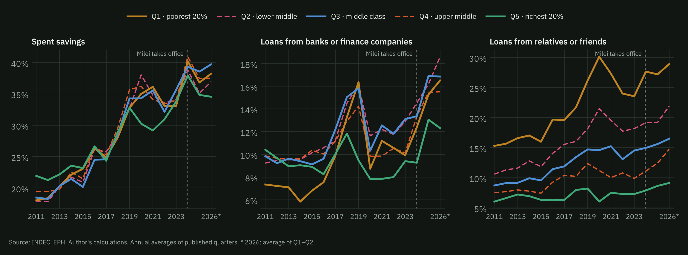
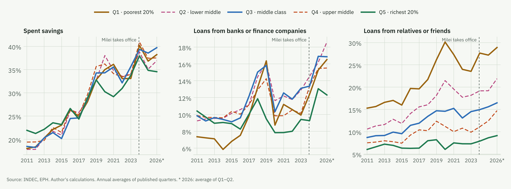
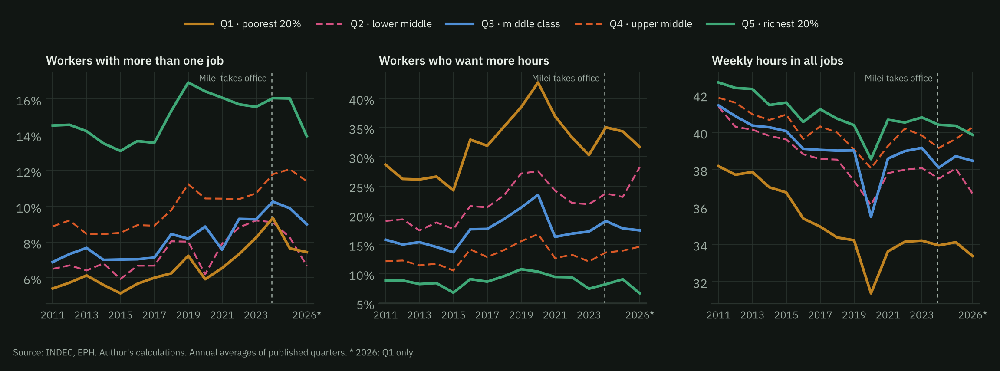
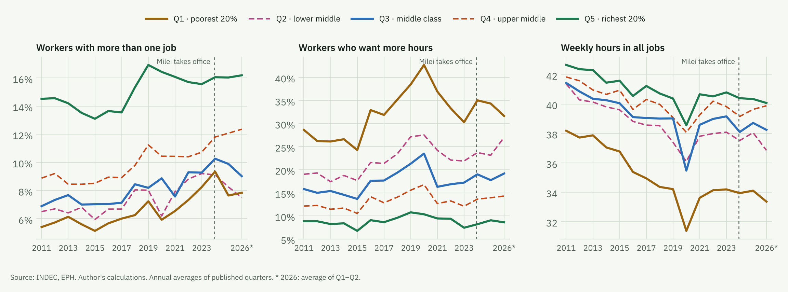
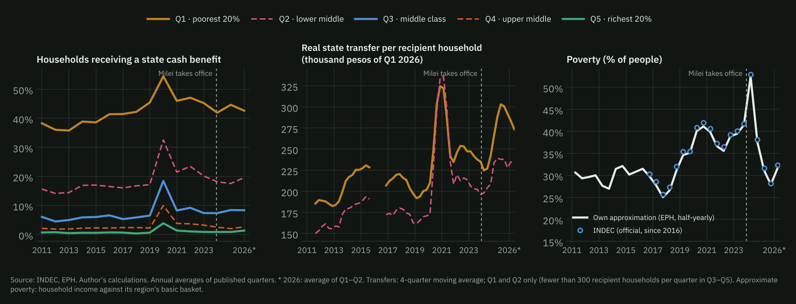
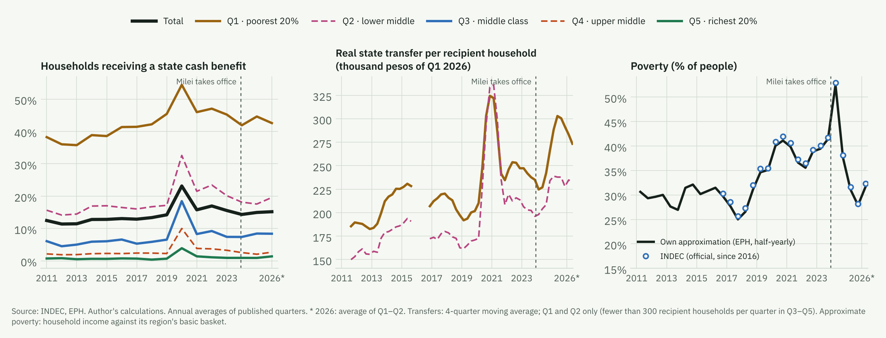
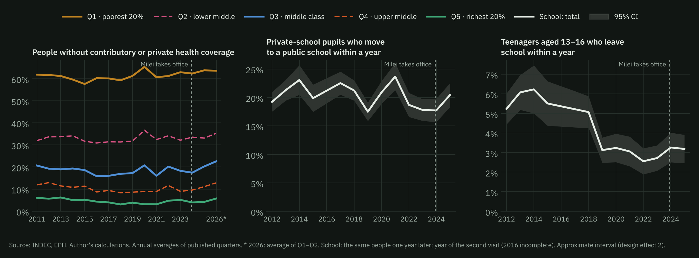
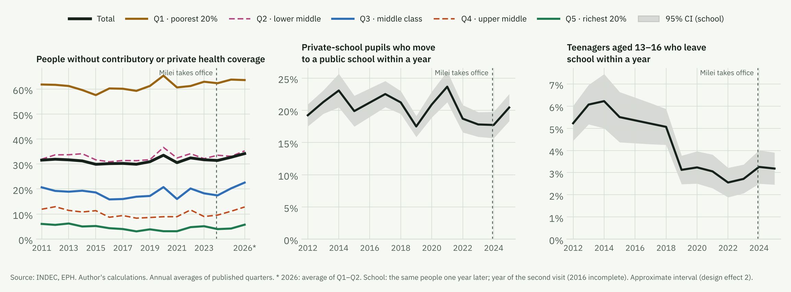
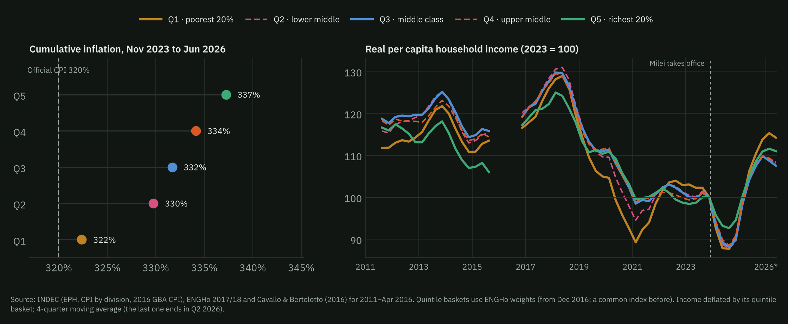
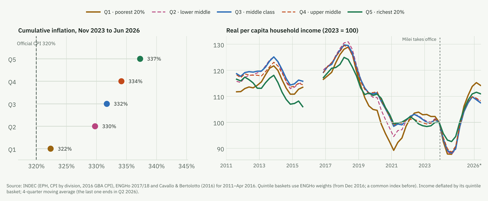

On 19 October, in Neuquén, the President asked how someone who runs out of money on the 20th could live ten days without eating or drinking. The question takes the expression literally. It seems childish to have to spell it out, but "not making it to the end of the month" does not describe someone who stops eating. It describes a household whose income does not cover its usual spending and which closes that gap with adjustments it had not planned for. Making it to the end of the month is a subjective notion for each family. For some it means not being able to save for the holidays. For others, buying lower-quality products or cutting the number of meals a day. The President looks at reality through a literal reading of economic theory, in which, if the price of a product goes up and you *substitute* that consumption for something else, it is a rational decision and not an adjustment. But not even the most classical theory sees it that way: whoever substitutes because something became more expensive ends up worse off. There lies the semantic myopia. The fallacy of literalism.

Now, the government maintained and increased transfers to the poorest households. That is why, when one looks at the macro numbers, this change in consumption (popularly known as… austerity) does not show up in poverty. According to [INDEC](https://www.indec.gob.ar/indec/web/Nivel4-Tema-4-46-152), the national statistics office, poverty fell from 41.7% of people in the second half of 2023 to 28.2% in the second half of 2025, and rose again to 32.3% in the first half of 2026. Structurally, there are no more poor people than before. The adjustment lies elsewhere, and a good part of it does show up in INDEC's Permanent Household Survey (EPH). This column looks at it channel by channel, using the microdata from 2011 to the second quarter of 2026.

Economic theory rests on simplifying people's behaviour in order to draw conclusions. Let us make some simplifications of our own. A household whose income falls short has, broadly speaking, four mechanisms at hand: **borrowing and dissaving** (spending savings, borrowing, selling things), **working more** (more hours, another job, another member who goes out to look for work), **receiving help** (from the State or from relatives) and **consuming less or worse**. To see who uses each one, we split the population into five groups of equal size according to the per capita income of their household (quintiles). The first is the poorest 20%; the second, the lower middle class; the third, the middle class; the fourth, the upper middle class; and the fifth, the richest 20%.

## Borrowing and dissaving, the mechanism that moved the most

The EPH asks whether, in the last three months, the household lived, among other things, off its savings or off loans. In the first quarter of 2024, 38.4% of households said they had spent savings, the highest value since 2011 (the previous peak, 36.7%, came in the middle of the pandemic). It happened equally across all quintiles. But it was a jump, not a trend. In 2025 it fell to 34.9%, and in the second quarter of 2026 it stood at 34.0%, barely above the levels of 2019 and 2023 (32.3% and 32.0%). What did change persistently was credit. Loans from banks and finance companies went from 10.1% of households in 2023 to 14.0% in 2025, and at the end of 2025 they hit a record (14.9%, when until 2024 the ceiling had been 14.0%). The survey question refers to loans from "banks, finance companies, etc.", so it probably also captures credit from digital wallets and other online platforms, which expanded a great deal in these years. According to the [Argentine Fintech Chamber](https://www.iprofesional.com/economia/437341-el-impresionante-crecimiento-de-los-creditos-de-las-fintechs-quienes-los-prefieren), in early 2025 some 5.2 million people had a loan from these platforms, 65% more than a year earlier.

Who borrows from banks and finance companies? A bit of everyone, because credit grew in all five quintiles. But the highest level is in the middle. In 2025, 16.9% of middle-class households did so, and 16.2% of lower-middle-class households, against 13.1% among the richest 20%; in the second quarter of 2026, the figure for the lower middle class had already reached 17.3%. The poorest finance themselves in other ways, with loans from relatives or friends (27.2% of first-quintile households in 2025, against 8.6% in the fifth) and by selling belongings (15.7%). Households whose main earner is a woman, or someone who did not finish secondary school, rely more on loans from relatives and friends (16.7% and 18.8%, against 14.7% and 10.5% when the main earner is a man or someone with a tertiary degree).

<figure class="nota-fig">

<figcaption>Borrowing and dissaving. Households that lived off each source in the last three months, overall and by quintile of household per capita income.</figcaption>
</figure>

## Working more, when there are no more hours

On the labour side, the adjustment of these years is less visible. It is true that more people hold more than one job today than a decade ago. In 2024 and 2025, 11.5% of the employed had more than one, when until 2017 the share had never exceeded 9%. But that rise predates 2024: it happened mostly between 2017 and 2019 and in the exit from the pandemic. Since 2023 the total has barely changed (10.8% in 2023), and the chart shows this in every quintile. It rose somewhat only in the upper middle class (10.7% to 12.1%) and fell in the two poorest quintiles (in the first, from 8.2% to 7.7%). Multiple jobholding is more common among women (14.7%, against 8.9% of men) and in the richest quintile (16.0%), where teaching, health and the professions abound.

Hours did not rise in any group either. Average hours across all jobs were 38.5 a week in 2023 and 38.1 in 2025; in the poorest quintile, 34.2 and 34.1. Those with a second job are not working more hours either (14.2 and 14.2 hours in the second job), and the share working more than 45 hours fell (30.0% to 28.9%). What grew is the number of people who want to work more and cannot, which went from 17.3% to 19.0% of the employed (in the poorest quintile, from 30.3% to 34.3%). There are more people looking for hours than hours available. And the employment that is growing is informal. According to the Interdisciplinary Institute of Political Economy at the University of Buenos Aires ([IIEP](https://economicas.uba.ar/iiep/panorama-del-empleo-asalariado-formal-y-de-las-remuneraciones-sep/)), in June 2026 there were 246,000 fewer formal private-sector wage jobs than in November 2023, and informality reached 45% of the employed in the second quarter of 2026, 1.8 points more than a year earlier, almost all of it due to the rise in self-employment ([IIEP](https://economicas.uba.ar/iiep/panorama-del-empleo-informal-y-la-pobreza-laboral-sep-2026/)).

Does another household member go out to work when the main earner's income falls? The EPH re-interviews the same households three months and one year later, which makes it possible to look. Among members who were neither working nor looking for work, 16.7% started doing so in the following quarter when the main earner's real income had fallen by more than 10%; 14.2% when it had held steady; and 17.3% when it had risen.[^1] When the main earner lost their job, the share was lower (13.4%). In the description, then, no clear "added worker" appears. Households whose incomes move, up or down, are also the ones that enter and leave the labour market most. And the fact that fewer members enter when the main earner loses their job may be because the blow hits the whole household at once (a family business that closes, a neighbourhood with no work). Separating cause from correlation is left for future research.

<figure class="nota-fig">

<figcaption>Working more. Employed people aged 10 and over, overall and by quintile; hours in all jobs.</figcaption>
</figure>

## Receiving help, or how the AUH holds up those at the bottom

In the poorest quintile, about half of households receive a State subsidy or benefit (45.2% in 2023, 44.6% in 2025); the Universal Child Allowance (AUH), which in the survey includes the Food Benefit (the former Food Card), reaches 42.0%. Further up, these transfers barely exist. Coverage did not change, but the amount did. The average transfer received by each first-quintile household, measured in today's pesos, was 24.1% higher in 2025 than in 2023, and went from 14.5% to 16.1% of its total income. Since December 2023 the AUH has risen faster than inflation, and in early 2024 so did the Food Benefit, which doubled and is an important part of what families receiving the AUH collect. Taken together, in May 2026 they were worth 52% more in real terms than in November 2023 ([Chequeado](https://chequeado.com/nota/luego-de-casi-2-anos-el-gobierno-aumento-un-383-la-tarjeta-alimentar-de-cuanto-es-el-nuevo-beneficio-y-cuando-se-cobra)). The Food Benefit, however, was frozen for almost two years from June 2024 and over that period lost 46% of its real value ([ODSA-UCA](https://repositorio.uca.edu.ar/bitstream/123456789/22321/1/prestacion-alimentar-aumento.pdf)). The other benefits were frozen too. The rise in these transfers accounts for about 3.5 points of the improvement in the poorest quintile's real income.

Help that does not come from the State also grew. Receiving goods in kind (from the State, churches or schools) became common during the pandemic and never went back, at 7.3% of the poorest households in 2019 and 19.7% in 2025. Help from relatives or neighbours who do not live in the household rose from 6.9% to 8.3% of all households.

<figure class="nota-fig">

<figcaption>Receiving help. Households receiving a State subsidy or benefit; real amount per recipient household; poverty (own approximation and INDEC's official figure).</figcaption>
</figure>

## Consuming less or worse

The EPH does not measure consumption. We do not know whether a household switched brands of yerba mate or stopped going to the cinema. Other sources do look at it, and they point in the same direction. According to the consultancy [Scentia](https://www.baenegocios.com/economia/el-consumo-masivo-cayo-2-7-interanual-en-junio-y-el-e-commerce-crecio/), mass consumption fell 2.9% in the first half of 2026 and is 17.1% below January 2023. [Worldpanel by Numerator](https://www.infobae.com/economia/2026/03/30/consumo-en-baja-los-hogares-argentinos-compran-menos-y-eligen-cada-vez-mas-marcas-economicas/) records households buying less often, in smaller volumes and more budget brands, and beef consumption, according to the industry chamber ([CICCRA](https://www.elancasti.com.ar/politica-y-economia/el-consumo-carne-los-argentinos-cayo-su-nivel-mas-los-ultimos-20-anos-n608286)), stands at 47 kilos per person a year, the lowest level in two decades. E-commerce, which is growing fast (41% year on year in June), is not enough to make up for it, because according to the [Argentine E-commerce Chamber](https://www.cronista.com/economia-politica/la-otra-cara-del-consumo-el-polemico-dato-que-usa-el-gobierno-para-defender-su-gestion/) it accounts for no more than 10% of sales in most companies.

What the EPH does ask about are two consumption items that matter: health coverage and school. In health, the share of people with neither social insurance (obra social) nor private health cover went from 31.7% in 2023 to 32.7% in 2025, and in the second quarter of 2026 it reached 34.2%. The rise was not at the bottom, where they were already the majority, but in the middle. In the middle class it went from 18.3% to 20.2% (and to 24.6% in the second quarter of 2026), and in the upper middle class from 9.0% to 11.1%. In the lower middle class, private cover shrank: it covered 4.9% of people in 2023 and 2.9% in 2025. That is more people who come to depend on the public hospital.

That consumption worsens while poverty falls is not a contradiction. Official poverty compares each household's income with the total basic basket, which is made up mostly of food, precisely what rose the least. Between November 2023 and June 2026 that basket rose 292%, against 320% for the CPI and 332% for the middle-class basket. With disinflation and the rise in the AUH, many households ended up above that line even though their income does not stretch to pay for private health cover, rent or school fees, which rose much more. The line measures whether a household can buy the basics, not whether it can keep up what it used to consume. On top of that, since 2024 the survey records some incomes better, above all pensions, and that alone lowers measured poverty.

At school the signal is weaker. Of the pupils who were in a private school, 20.4% were in a public one a year later in 2025, against an average of 18.1% between 2022 and 2024. It is not a record (in 2021 it was 23.7%), and the difference is at the edge of the survey's margin of error, with no differences between girls and boys. School dropout among 13- to 16-year-olds, which the literature on Argentine crises links to the household head losing their job ([Ciaschi and Neidhöfer, 2024](https://doi.org/10.1093/wber/lhad041)), shows no increase for now (3.2% in 2025, against 2.8% between 2022 and 2024).[^2]

<figure class="nota-fig">

<figcaption>Consuming worse. Health coverage overall and by quintile (cross-section) and school (the same people one year later; national total with its margin of error).</figcaption>
</figure>

## Prices did not rise equally for everyone

Not all households buy the same things, and the average hides it. INDEC's CPI still uses the 2004/05 basket as weights. If the spending structure of each quintile from the 2017/18 National Household Expenditure Survey (ENGHo) is used instead, between November 2023 and June 2026 the basket of the poorest 20% rose 322%, that of the middle class 332% and that of the richest 20% 337%, against 320% for the official CPI. The reason is composition. Food, which is 34.5% of spending in the poorest quintile and 15.7% in the richest, rose 293%, well below housing and utilities (602%), education (443%), communications (427%) or transport (383%).

Why does it matter? Because wage agreements and pensions are adjusted, when they are adjusted, by the average. If what you consume rose more than the average, a raise equal to official inflation does not give you back your purchasing power. Over these two and a half years, the baskets of all quintiles rose more than the official CPI, and the more so the higher the income. From the middle class upwards, the gap is already more than ten points.

## Who is not making it

If each quintile's income is deflated by its own quintile's basket, real per capita income in 2025 was 13.8% higher than in 2023 in the poorest quintile, 10.9% in the richest and between 9.7% and 9.9% in the three middle ones. In the latest data the difference is starker. In the second quarter of 2026, compared with the same quarter of 2023, the first quintile was 6.1% higher and the fifth 7.2%, but the lower middle class only 2.6%, the middle class 1.1% and the upper middle class 1.1%.

But 2023 was a year of very high inflation and is too low a benchmark. The comparison that matters most is with 2017, the last year with inflation of the current order before the 2018 crisis. Compared with 2017, real income in 2025 is still 14.6% lower in the lower middle class and 14.0% in the middle class, and also 9.7% lower among the poorest 20% and 9.3% among the richest. No group has returned to that level, and most are barely where they were in 2019, before the pandemic and the inflationary spiral that followed. That memory, of having been able to buy more a few years ago, is the yardstick each family uses to judge whether it is making it or not. And perhaps it is easier to use now. With high inflation, prices stop being a good guide, and comparing what used to be enough with what is enough today becomes almost impossible ([Heymann and Leijonhufvud, 1995](https://econpapers.repec.org/RePEc:oxp:obooks:9780198288442)). With lower inflation, the comparison becomes possible again. It is the B-side of disinflation: purchasing power improves, but so does the ability to realise how much was lost.

<figure class="nota-fig">

<figcaption>Relative prices and real income, overall and by quintile.</figcaption>
</figure>

That real income rose in every quintile compared with 2023 also has a measurement explanation. Since late 2023 INDEC has asked separately about pensions, their bonuses and back pay, and about each type of transfer, and since 2024 the EPH has captured these non-labour incomes better. According to [Equilibra](https://equilibra.ar/wp-content/uploads/2025/12/251229-Por-que-bajo-tanto-la-pobreza.pdf), the pensions reported in the survey went from the equivalent of 85% of what ANSES, the social security agency, pays out to exceeding it (110%). For labour incomes the debate is more open. The wage of registered employees reported in the survey rose 42.7% in the fourth quarter of 2025, against 32.0% in administrative records (SIPA) and inflation of 31.5%, but the questionnaire change did not target those incomes and there is no agreement on the cause of the gap. Several economists estimate that a significant part of the fall in poverty is due to the improvement in measurement.[^3]

The government argues that informal workers are driving the recovery. In the EPH, the real income of unregistered employees did indeed rise 24.3% between 2023 and 2025 and that of the self-employed 29.4%, against 12.7% for registered employees. There are three caveats. The first is measurement. The rise the survey records for non-employees (70% year on year at the end of 2025, according to [Equilibra](https://www.infobae.com/economia/2026/04/07/el-cambio-del-indec-en-la-medicion-de-ingresos-distorsiono-el-dato-de-baja-de-la-pobreza-segun-un-estudio-privado/)) is hard to reconcile with other indicators, and the official index of unregistered wages comes from the same EPH with a lag of about six months, which distorts comparisons between periods of high and low inflation ([Tiempo Argentino](https://www.tiempoar.com.ar/ta_article/espejismo-libertario-de-los-salarios-informales-que-vuelan/)). The second is the starting point, because compared with 2017 informal workers are still lower too (6.7% for unregistered employees). The third is the level. An unregistered employee earns on average 48% of what a registered one earns. Even comparing workers with the same education, age, sector and firm size, the [IIEP](https://economicas.uba.ar/iiep/panorama-del-empleo-informal-y-la-pobreza-laboral-sep-2026/) estimates that an informal worker earned 34% less than a formal one in early 2026. The gap has narrowed (39% a year earlier), but it is still large. And unregistered workers are still more than a third of all employees (36.7% in 2025). All in all, what can be stated with confidence is the comparison between income groups, in which the middle class is the one that has recovered least.

## Four mechanisms: so where does that leave us?

Set side by side, the four mechanisms tell a coherent story. Two forces outside the household's control push in opposite directions. State help protects those at the bottom, because the AUH rose faster than inflation and State transfers are now a sixth of the poorest quintile's income. Prices, by contrast, punish more the higher up one is, because services, education and transport, which rose the most, weigh more in those baskets. The poorest 20% have the help and the richest 20% a cushion of income and savings. The middle class has neither. It receives no transfers and its basket became almost as expensive as that of the rich, which is why its real income is the one that has recovered least.

That is why the mechanisms that depend on the household itself are concentrated in the middle. It is the middle class that borrows most from banks and finance companies and that most often lost social insurance or private health cover. The poorest finance themselves through relatives and by selling belongings, and want to work more hours that they cannot find. Work is stuck for everyone, with hours flat and more people looking for hours that are not there. None of these pressures shows up in the poverty rate, which measures the distance to a line and not the cost of staying above it.

## See for yourself

Interactive chart with each channel from 2011 to 2026, by income quintile and by the gender and education of the household’s main earner (labels in Spanish).

<iframe id="fdm-ix" src="/notas/no-llegar-a-fin-de-mes/interactivo.html?tema=oscuro" title="Not making ends meet: household coping mechanisms, 2011–2026" loading="lazy"></iframe>

## What these data do not say

Everything above describes how each mechanism changed, not how much of that change is due to the fall in income; these are not causal effects. The EPH covers 31 urban areas. The comparisons use annual averages, so as not to compare isolated quarters, and in the charts 2026 includes only the quarters already published.[^4] The charts mark with a dotted line the inauguration of the current government, in December 2023.[^5] The quintile basket uses 2017/18 weights without substitution, so it is an upper bound on the difference between baskets.

Nobody lives ten days without eating. What millions of households do is something else. They spend what they had saved, they borrow, they look for more hours of work, they drop their private health cover, they move the children to public school and they buy cheaper. The relevant question is not whether people eat on the 25th, but how much it costs them to get there, and who pays that cost.

If Paul McCartney comes back to Argentina, perhaps the President could ask him why [Lady Madonna](https://www.thebeatles.com/lady-madonna-0) did not die on the 20th. *Lady Madonna, children at your feet. Wonder how you manage to make ends meet*.
Paul does not ask her whether she has eaten. He knows people find a way. What intrigues him is how she does it.

---

*References:* Cavallo, A. and Bertolotto, M. (2016). "Filling the Gap in Argentina's Inflation Data", MIT Sloan. Ciaschi, M. and Neidhöfer, G. (2024). "Job Loss and Household Labor Supply Adjustments in Developing Countries: Evidence from Argentina", *The World Bank Economic Review*, 38(3), 558–579. Heymann, D. and Leijonhufvud, A. (1995). *High Inflation*. Oxford: Clarendon Press. *Data:* INDEC (EPH, CPI, ENGHo 2017/18, total basic basket; poverty reports).

[^1]: Averages for 2017 to 2025 (one year ahead, 2017 to 2024), people aged 14 to 64 who are not the household's main earner. One year later the values are 23.4%, 21.7% and 23.5%. Income is deflated with the CPI.

[^2]: These are the same people interviewed one year apart: 2,831 private-school pupils and 4,526 children aged 13 to 16 in 2025. Split by quintile or by gender, the groups are too small to distinguish changes from one year to the next.

[^3]: The comparison with SIPA and RIPTE is by the consultancy Equilibra. CEDLAS (National University of La Plata) estimates that, correcting for measurement, poverty would have fallen by about 2 points between the second half of 2023 and the first half of 2025, not the 10 points of the official figure ([Infobae, 7 April](https://www.infobae.com/economia/2026/04/07/el-cambio-del-indec-en-la-medicion-de-ingresos-distorsiono-el-dato-de-baja-de-la-pobreza-segun-un-estudio-privado/) and [14 April 2026](https://www.infobae.com/economia/2026/04/14/las-cifras-de-la-pobreza-en-la-argentina-por-que-la-baja-de-los-indicadores-desato-un-intenso-debate-entre-economistas/)). Since pensions and transfers weigh differently in each quintile, the improvement in capture is not necessarily even. It overstates everyone's income growth, and more so for the groups where those incomes weigh more. There are no published estimates by quintile to tell whether the ranking between them changes.

[^4]: Since 2026 has only the first and second quarters, we redid all the comparisons using first halves only, to rule out calendar effects. Seasonality is small: the first half deviates from the annual average by at most 0.4 points on average, except for multiple jobholding, which is 0.5 points lower in the first half. No conclusion changes. The details are in the technical report.

[^5]: The figures for 2011 to 2015 correspond to the period in which INDEC itself recommends reading its statistics with caution; to deflate those years the price series of [Cavallo and Bertolotto (2016)](https://www.thebillionpricesproject.com/wp-content/uploads/sites/2/2025/09/FillingTheGap_es.pdf) is used. They are shown as context, not as a point of comparison.
