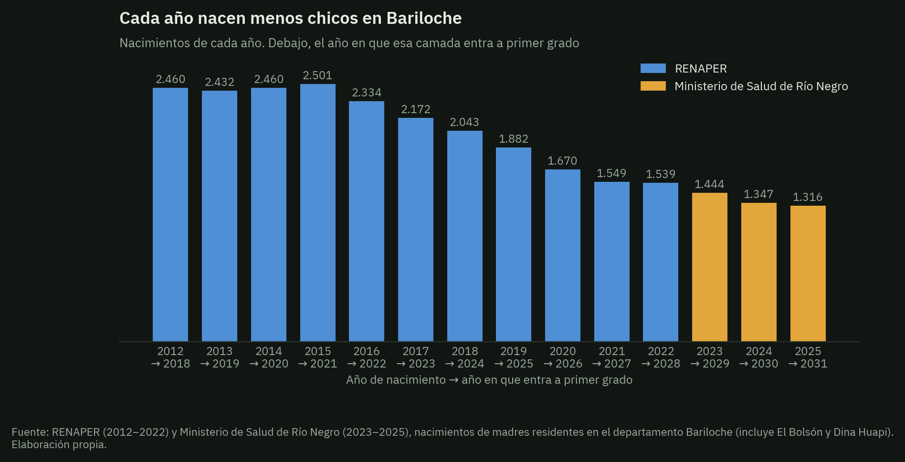
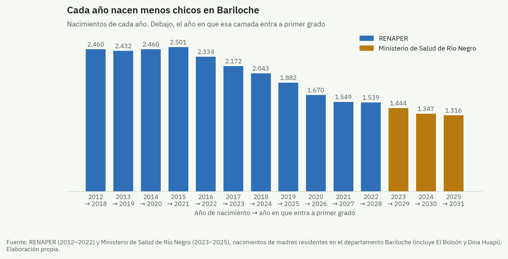
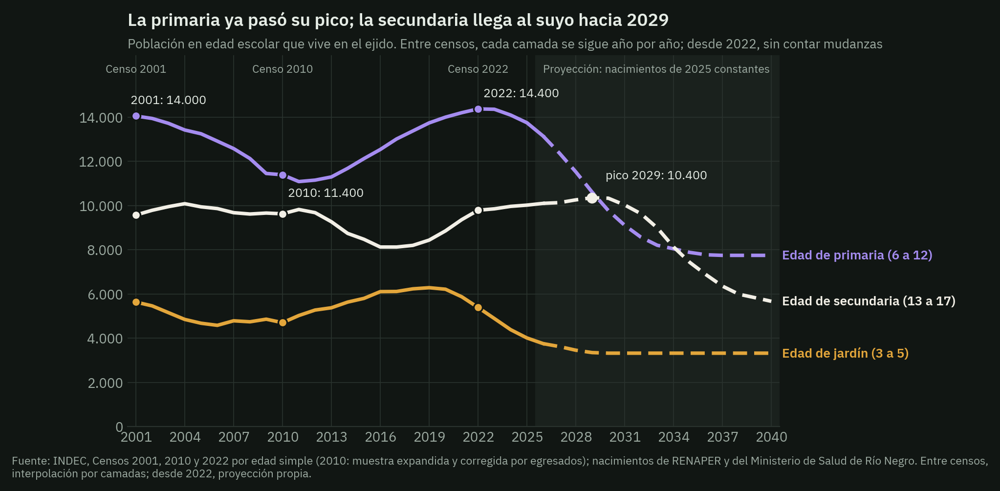
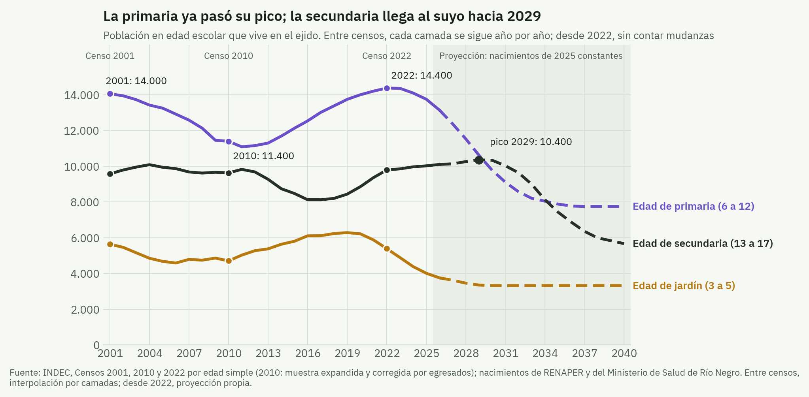
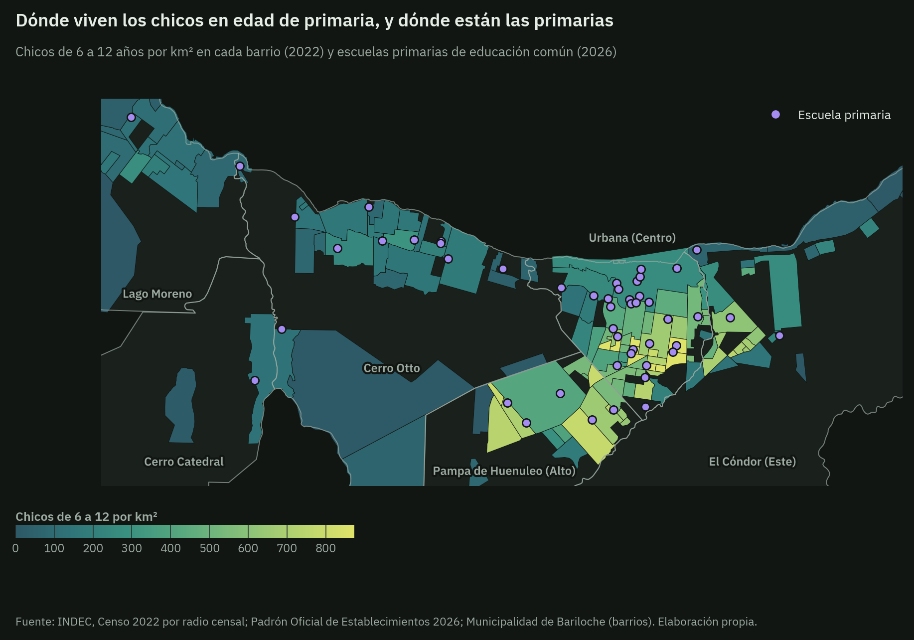
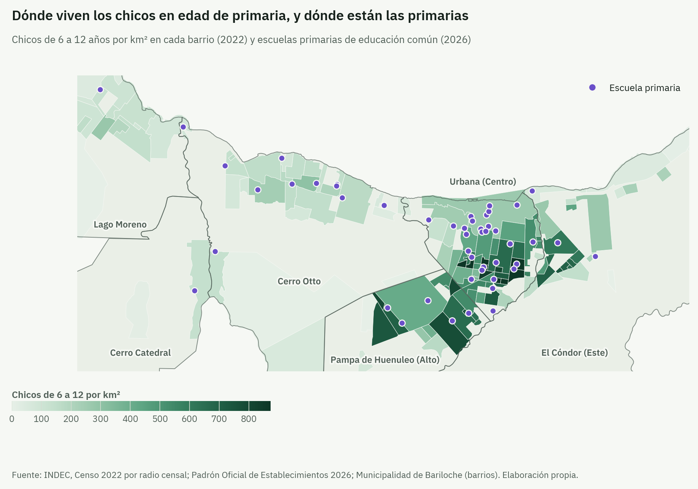
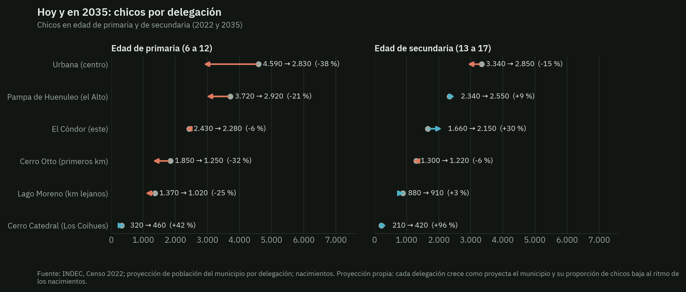
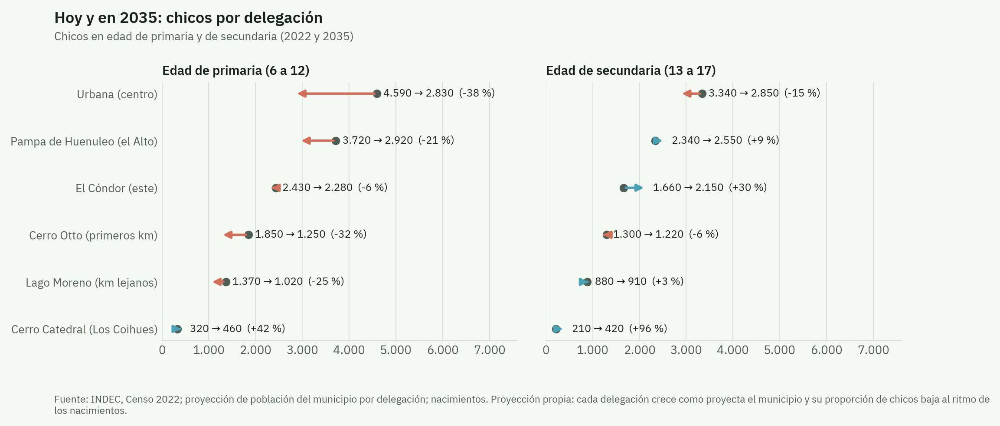

Es mi primera nota en Bariloche2000. Me presento: soy Matías, barilochense nacido y criado. Estudié en el Colegio
Integral Vuriloche y en el Instituto Dante Alighieri, después me fui a Buenos Aires a estudiar Economía en la UBA y,
finalmente, a Inglaterra a hacer mi doctorado. Hace siete años que vivo en Europa y hoy trabajo como profesor en la
Universidad de Utrecht, en Holanda.

Desde que me fui tengo una costumbre que no se me va. Cada vez que algo me sorprende afuera, me pregunto qué pasaría con
eso en Bariloche. No lo puedo evitar, y de eso se trata esta columna. Que no se malinterprete: no pienso importar recetas.
Bariloche tiene cosas que no tiene ningún otro lugar, y algunos de sus problemas tampoco se parecen a los de nadie. Pero
ver cómo otros resolvieron (o no) algo parecido ayuda a pensar qué se puede hacer acá. Por suerte, hay muchísimos datos
abiertos que nos pueden servir para estudiar y repensar la ciudad.

Empecemos con una anécdota. En Holanda voy al trabajo en bicicleta. Llueva, que pasa seguido, o nieve, que pasa menos,
pero pasa. El camino atraviesa un bosque por una bicisenda doble mano, y si salgo a la hora equivocada me encuentro en
medio de un embotellamiento muy particular, el de cientos de niños y adolescentes camino a la escuela. Algunos van muy rápido, sobre todo los de bicicleta
eléctrica, que juegan a ser Colapinto (en sus peores carreras).

Da la impresión de que allá hay más chicos, pero es sólo una impresión. En 2017, una mujer argentina tenía en promedio
2,1 hijos y una holandesa 1,6. Sin embargo, hoy en la Argentina nacen menos chicos por mujer que en
Holanda (1,3 contra 1,4).[^1]
Las aulas argentinas todavía tienen las camadas grandes de hace una década, pero las que vienen detrás son cada vez más
pequeñas. La diferencia que se nota en la calle es otra: allá los estudiantes se ven más, simplemente porque van a la
escuela solos, sin auto ni colectivo.

Y eso se percibe en el tránsito. Cada chico que va en bicicleta es un auto menos en la puerta de la escuela, y un padre o
una madre que puede ir directo al trabajo, o trabajar desde su casa, sin pasar parte de la mañana al volante.

Imaginar una Bariloche a la holandesa sería un poco utópico. Tenemos viento patagónico, pendientes que desaniman al más
entusiasta y muy pocas ciclovías. Pero la pregunta de fondo sirve igual. Quien haya cruzado la ciudad en horas pico conoce
el centro trabado y las filas sobre las avenidas Bustillo y Pioneros. Entre esos viajes están, cada día hábil, los de cientos de estudiantes. Y aunque parezca una paradoja, mientras Bariloche crece, cada año hay menos
nacimientos. Eso debería aliviar el tránsito escolar, y lo haría si las escuelas no estuvieran en el centro y las
familias no vivieran cada vez más lejos.

La idea de esta nota es cruzar tres datos que casi nunca se miran juntos: cuántos chicos nacen, dónde viven y dónde están
las escuelas. La conclusión es incómoda: **la ciudad va a tener cada vez menos chicos, y cada vez más lejos de las
escuelas.** Que hagan falta más o menos escuelas depende, sobre todo, de dónde.

## Casi la mitad de nacimientos que hace trece años

En 2012 hubo en Bariloche 2.460 nacimientos. En 2025 fueron 1.316, un 47 % menos. En Río
Negro la caída fue parecida (49 %), y en el país los nacimientos bajaron un
38 % sólo entre 2012 y 2022.[^2] Bajó mucho el embarazo adolescente, y eso es una gran noticia. Como en buena parte del mundo, las mujeres tienen su primer hijo a mayor edad y las familias son más
pequeñas. La camada que va a empezar primer grado en 2027 es un 37 % más chica que la que empezó
en 2018.

<figure class="nota-fig"></figure>

## Más escuelas, y camadas numerosas que ya dejan la primaria

Mientras tanto, la oferta creció. En 2011, el ejido municipal tenía 95 establecimientos de educación
común con jardín, primaria o secundaria. Hoy son 115, un 21 % más.[^3]

Que haya más escuelas y menos nacimientos no es una contradicción. La cantidad de chicos en edad escolar no depende de
cuántos nacen hoy, sino de cuántos nacieron entre seis y diecisiete años atrás. Y las camadas más numerosas, las nacidas
entre 2012 y 2015, recién están dejando la primaria. Suponiendo que no se mudara más gente a la ciudad, **de unos
14.400 chicos en edad de primaria en 2022 se pasaría a unos 9.800 hacia 2030.** La secundaria todavía
los está recibiendo, y la cantidad de adolescentes va a seguir creciendo hasta 2029 (un 6 % más
que en 2022). Después cae, y rápido.[^4]

<figure class="nota-fig"></figure>

Con menos chicos y más escuelas, la conclusión fácil sería que van a sobrar lugares. Pero pueden sobrar en un barrio y
faltar en otro.

## Las escuelas quedaron en el centro y la ciudad creció hacia afuera

El municipio divide la ciudad en seis delegaciones, cuyos nombres oficiales no siempre coinciden con los que usa la gente.
Urbana es el centro y los barrios que lo rodean. Cerro Otto abarca los primeros kilómetros, entre la Bustillo y la
Pioneros, y Lago Gutiérrez. Lago Moreno son los kilómetros más lejanos, hasta Llao Llao y Colonia Suiza. Cerro Catedral
es Villa Los Coihues y la base del cerro. Pampa de Huenuleo es buena parte del Alto, y El Cóndor es el este, con Las
Victorias y Las Chacras. Para esta historia vamos a poner el foco en tres: el Centro, el Alto y el Este.

Entre 2010 y 2022, Bariloche sumó unos 22.300 habitantes y todo ese crecimiento fue hacia las afueras de la
ciudad. El Centro perdió un 4 % de su población. El Este creció un 77 % y el
Alto, un 50 %. Entre los más jóvenes, el cambio fue todavía más marcado. En 2022, el Centro
tenía unos 2.500 menores de 18 años menos que en 2010 (−18 %), mientras que en todas
las demás delegaciones aumentaron.

El resultado es una ciudad con dos mapas superpuestos: el Alto y el Este juntan el 42 % de los niños y
adolescentes, pero sólo el 17 % de las escuelas primarias. El Centro, con el 34 % de los
chicos, tiene el 54 %.

El Centro, en cambio, se llenó de alojamientos turísticos. Hoteles hubo siempre. La delegación Urbana concentra el
57 % de las plazas hoteleras registradas, unas 28 camas por cada 100 habitantes, y en el
Este no llega a una (0,8). Lo que se sumó en los últimos años son casas y departamentos que antes eran
viviendas. Con Airbnb y Booking, a un propietario le puede rendir más alquilarle a turistas unos días que a una familia
todo el mes. Hoy hay unos 2.400 anuncios de Airbnb en el Centro, el 91 % casas o
departamentos enteros, casi 10 por cada 100 viviendas.[^5] Según el
censo de 2022, que se hizo en mayo, en plena temporada baja, el 12 % de las viviendas del Centro estaba
vacía ese día, contra el 5 % en el Este. Si alquilar para vivir en el Centro se vuelve más caro, muchas
familias terminan buscando en las afueras. Los turistas, a diferencia de los chicos, duermen cerca de las escuelas.

## Lejos de la escuela

El mapa que sigue muestra todos los barrios de la ciudad y la ubicación de las escuelas primarias. Cuanto más intenso es
el color del barrio, más chicos en edad de primaria viven en cada kilómetro cuadrado. Las escuelas se concentran en el
Centro y a lo largo de la avenida Bustillo. **Donde viven más chicos, hay menos escuelas.**

<figure class="nota-fig"></figure>

En el Este hay unos 810 chicos de 6 a 12 años por cada primaria. En el Centro son unos
160, 5 veces menos. Un 10 % de la población de 6 a 12 años
(1.400 de las 14.400 personas) vive a más de un kilómetro y medio en línea recta de la escuela más
cercana, en su mayoría en la periferia. Y esa escuela no siempre tiene lugar ni es la que elige la familia.

Para una familia sin auto, esa distancia es un colectivo de ida y otro de vuelta. Para la que tiene auto, son dos viajes
más por las mismas avenidas, ya saturadas. Para los chicos es tiempo, y el tiempo de viaje importa. Por ejemplo, un
estudio en Noruega encontró que, por cada media hora más de viaje hasta la secundaria, de cada 100 alumnos unos 2 menos
la terminan a tiempo.[^6]

## La ciudad va a seguir creciendo hacia las afueras

La Municipalidad proyecta que Bariloche pase de unos 136 mil habitantes en 2022 a 184 mil en 2035. El
84 % de ese crecimiento cae fuera del Centro. Con la migración que se proyecta hacia la ciudad, la caída
en la cantidad de chicos es más suave que en el supuesto anterior. Si cada zona crece como proyecta el municipio y la
natalidad sigue como hoy, en 2035 la ciudad tendría un 25 % menos de chicos en edad de primaria que
en 2022, una caída de más de un 2 % por año.[^7]

Si ajustamos el lente, vemos que la caída no se reparte igual. En el Centro sería del 38 % y en el
Este, del 6 %. En la secundaria la diferencia es más grande. El Centro perdería un
15 % de sus adolescentes y el Este ganaría un 30 %. Cerro Catedral, junto
con Villa Los Coihues, que hoy no tiene ninguna secundaria, casi duplicaría los suyos (96 %
más).

<figure class="nota-fig"></figure>

Si no se abriera ninguna escuela, la brecha entre el Este y el Centro crecería. En 2035 habría en el Este unos
760 chicos en edad de primaria por cada escuela primaria, contra unos 100 en el
Centro. Qué pase con los lugares que queden libres en el Centro depende de decisiones que todavía no se tomaron. Puede
haber grados con menos alumnos, escuelas que se reorganicen o, si no se hace nada, más chicos viajando desde las afueras
y una rotonda del Ñireco que se parezca (todavía más) a la General Paz. En la ciudad de Buenos Aires, el gobierno porteño
ya cerró secciones de primer y segundo grado en escuelas estatales porque los ingresantes cayeron un 25 % entre 2020 y
2025 ([Infobae, 15/10/2025](https://www.infobae.com/sociedad/2025/10/15/baja-de-natalidad-y-educacion-las-escuelas-portenas-cierran-grados-y-docentes-y-familias-toman-medidas-para-evitarlo/)).

## Lo que se podría hacer

La escena de la bicisenda depende menos de la bicicleta que de la distancia. Un alumno va solo a la escuela cuando le
queda cerca y el camino es seguro. **En Bariloche nadie va a cambiar el viento ni las pendientes, pero sí se puede decidir
dónde están las escuelas.**

Un [estudio de Argentinos por la Educación](https://chequeado.com/nota/aulas-con-menos-alumnos-se-estima-que-caera-un-27-la-matricula-escolar-para-2030-en-la-argentina)
proyecta que la matrícula primaria del país va a caer un 27 % entre 2023 y 2030. Esa caída puede leerse como un problema
o como una oportunidad. Con menos alumnos por aula se puede, por ejemplo, extender la jornada, abrir salas de tres años
donde faltan y reforzar a los chicos que vienen atrasados.

Pero eso no pasa solo. Si los cargos docentes y los edificios se quedan donde están, los chicos de la periferia van a
tener que viajar cada vez más lejos, o las aulas del Centro van a quedar semivacías. Hay decisiones que se pueden tomar
antes. Abrir cursos y, con el tiempo, escuelas donde la ciudad crece, empezando por secundarias en el Este y en Cerro
Catedral. Pensar los recorridos y los horarios del transporte público con el mapa escolar en la mano, y usar el espacio
que deja la baja de la natalidad en el Centro para mejorar, no para cerrar.

Para eso falta un dato importante: cuántos alumnos tiene cada escuela.[^8] Con él, la provincia de Río Negro y la ciudad podrían planificar sus escuelas para 2035 en
lugar de correr detrás de los problemas.

La próxima vez que me pase un Colapinto de doce años camino a la escuela, voy a intentar pensar menos en su bicicleta
eléctrica y más en lo fácil que le resulta llegar a su aula. Y en que quizás, algún día, en algún barrio del Alto o del
Este con la escuela a pocas cuadras, se arme a la mañana un embotellamiento de chicos yendo a clase. Eso sí, a pie. Con
nuestro viento cordillerano, sería lo más prudente.

## Para mirar por tu cuenta

<iframe class="mapa" title="Mapa interactivo de escuelas y chicos" src="/assets/dashboards/bariloche_escuelas_mapa_es.html" style="height:900px;width:100%;border:0" loading="lazy"></iframe>

<strong>Cómo se usa.</strong> Arriba elegís qué mirar: por barrios o por delegaciones, y el indicador con el que se colorea el mapa (por ejemplo, el cambio en los chicos entre 2010 y 2022, o cuántos chicos de 6 a 12 hay por primaria). Cada punto es un edificio escolar de educación común; si en el mismo edificio hay jardín, primaria o secundaria, el punto lleva los colores de cada nivel, y con los botones de «Escuelas» podés dejar sólo uno. Tocá un barrio, una delegación o una escuela para ver sus números y la lista de escuelas a la derecha. Con «Resaltar barrios» quedan marcados, por ejemplo, los barrios sin primaria propia. La rueda del mouse (o dos dedos en el celular) acerca el mapa hasta ver las calles; «Sin color» deja sólo el mapa de calles.

---

*Cómo lo medimos.* Los chicos por barrio y por delegación salen del censo 2022 por radio censal, repartidos entre los
barrios del mapa municipal según la superficie. Las escuelas son las de educación común del padrón oficial 2026 que
tienen jardín, primaria o secundaria (115), ubicadas con la dirección del padrón y, cuando no
alcanzó, a mano. La proyección de población es la del tablero «Proyección Población» de la Municipalidad; la de chicos
por edad es propia. Las plazas hoteleras son las del mapa de establecimientos del municipio (2022). El [reporte técnico completo](/es/notas/bariloche-escuelas/reporte/), con las fuentes, los métodos y sus límites, está en una página aparte.

[^1]: Tasa global de fecundidad, es decir, cuántos hijos tendría en promedio una mujer que a cada edad tuviera los hijos que tuvieron ese año las mujeres de esa edad. Argentina: INDEC, *Estimaciones y proyecciones de población 2022–2040* (2017, estimada; 2025, proyección de la variante media) ([INDEC](https://www.indec.gob.ar/ftp/cuadros/publicaciones/proyecciones_nacionales_2022_2040.pdf)). Países Bajos: Centraal Bureau voor de Statistiek, 2017 y 2024 ([CBS, 2018](https://www.cbs.nl/-/media/_pdf/2018/51/2018st27-kernprognose-2018-2060-immigratie-blijft-hoog.pdf); [CBS, 2026](https://www.cbs.nl/nl-nl/nieuws/2026/22/in-bijna-alle-gemeenten-kregen-vrouwen-tussen-2014-en-2024-minder-kinderen)).

[^2]: Nacimientos de madres que viven en el departamento Bariloche, que además de la ciudad incluye El Bolsón y Dina Huapi. RENAPER hasta 2022 y Ministerio de Salud de Río Negro desde 2023; en los años en que las dos fuentes se solapan difieren menos de un 2 %.

[^3]: Contamos establecimientos del padrón oficial, no vacantes ni alumnos: una escuela puede tener una sección por grado o cuatro. Algunos colegios privados inscriben el jardín y la primaria con un código y la secundaria con otro; agrupados, los 115 establecimientos de 2026 son 103 instituciones en 90 edificios.

[^4]: Proyección propia, sin contar mudanzas: los chicos que contó el censo 2022 envejecen un año por año y los nacidos desde 2023 se suman según los nacimientos del departamento. Desde 2026 se suponen nacimientos iguales a los de 2025. El detalle está en el reporte técnico.

[^5]: Anuncios de Airbnb dentro de la delegación Urbana el 12 de noviembre de 2026 (relevamiento propio), contra las viviendas del censo 2022. Un anuncio no es necesariamente una vivienda distinta, y no todas las viviendas que se alquilan a turistas están en Airbnb.

[^6]: Falch, T., Lujala, P. y Strøm, B. (2013). «Geographical constraints and educational attainment», *Regional Science and Urban Economics*, 43(1), 164–176. La cifra exacta es 2,3 puntos porcentuales menos de probabilidad de terminar la secundaria a tiempo, sobre todo entre los alumnos con notas regulares.

[^7]: Proyección propia: la población de cada delegación en 2035 es la del municipio y la proporción de chicos de cada edad es la del censo 2022, corregida por la baja de la natalidad. El detalle está en el reporte técnico.

[^8]: La matrícula por escuela, anonimizada, fue pedida al Ministerio de Educación de la Nación y al de Río Negro por la ley de acceso a la información pública. Al cierre de esta nota no había respuesta.
