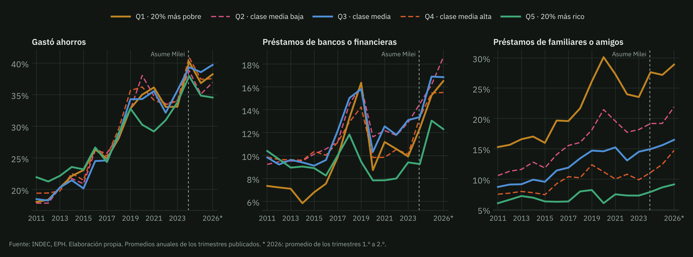
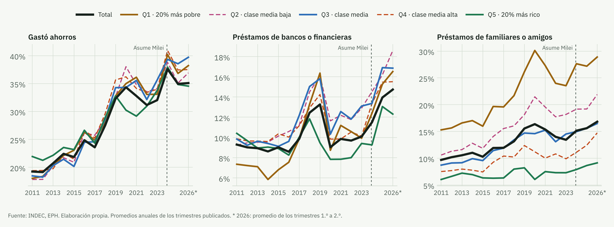
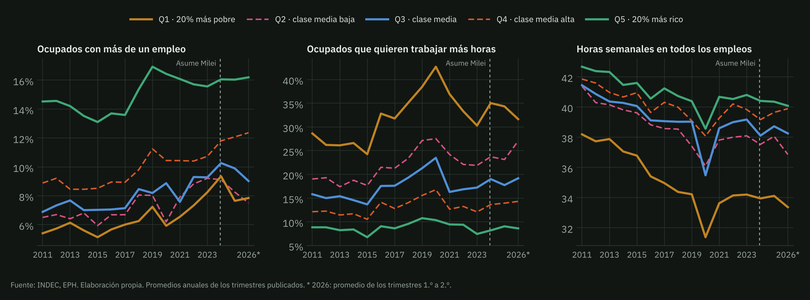
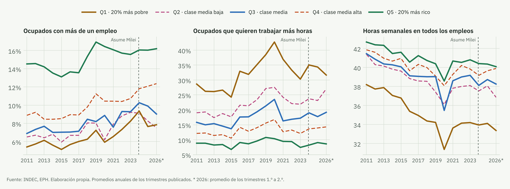
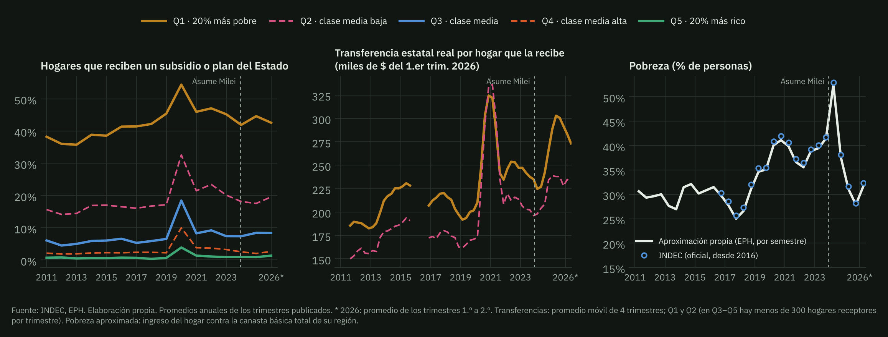
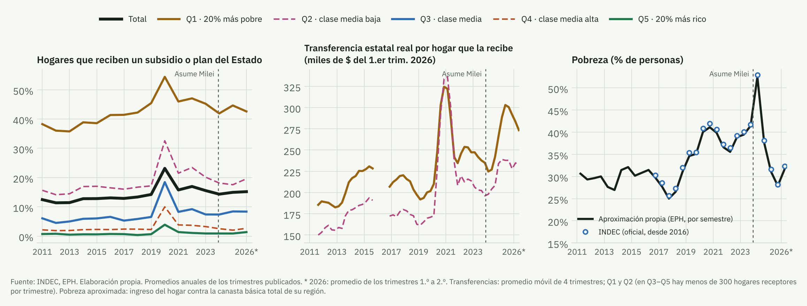
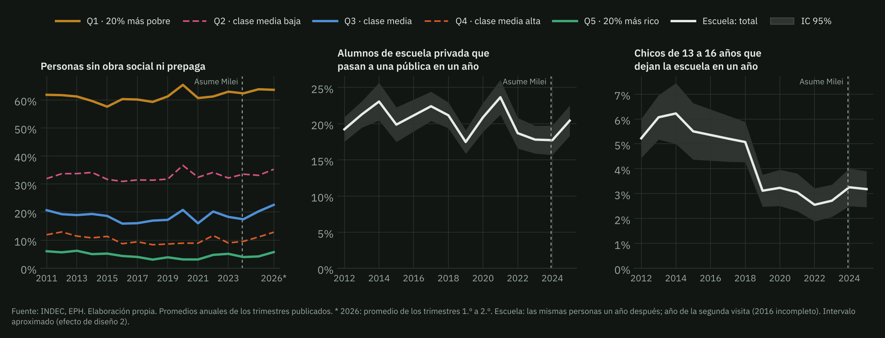
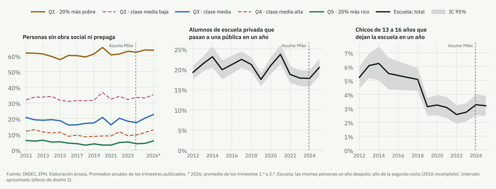
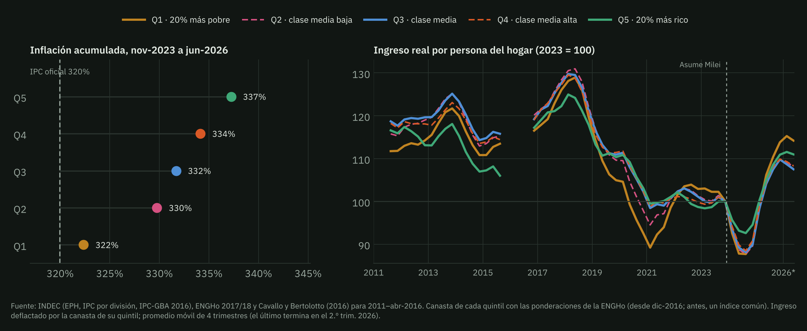
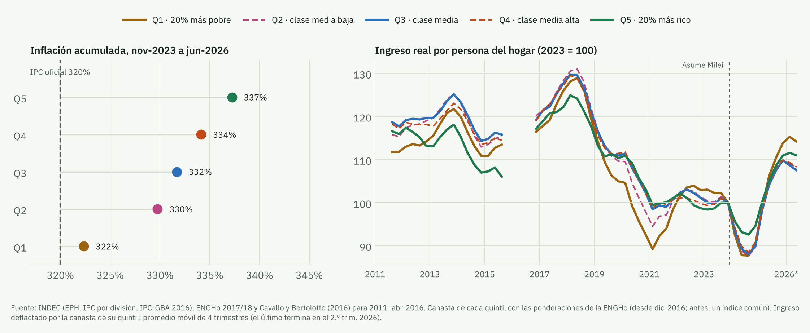

El 19 de octubre, en Neuquén, el Presidente se preguntó cómo haría alguien que se queda sin plata el día 20 para vivir diez días sin comer ni beber. La pregunta toma la expresión al pie de la letra. Parece infantil tener que aclararlo, pero «no llegar a fin de mes» no describe a alguien que deja de comer. Describe un hogar cuyo ingreso no cubre su gasto habitual y que cierra esa brecha con ajustes que no tenía contemplados. Llegar a fin de mes es un concepto subjetivo para cada familia. Para algunas implica no poder ahorrar para las vacaciones. Para otras, consumir productos de menor calidad o reducir la cantidad de comidas por día. El Presidente mira la realidad desde una lectura literal de la teoría económica, en la que si el precio de un producto sube y uno *sustituye* ese consumo por otro, se trata de una decisión racional y no de un ajuste. Pero ni siquiera la teoría más clásica lo ve así: el que sustituye porque algo se encareció, queda peor. He ahí la miopía semántica. La falacia por literalidad.

Ahora bien, el gobierno sostuvo e incrementó las transferencias a los hogares más pobres. Por eso, cuando uno mira los números macro, ese cambio de consumos (popularmente conocido como… ajuste) no aparece en la pobreza. Según el [INDEC](https://www.indec.gob.ar/indec/web/Nivel4-Tema-4-46-152), bajó de 41,7% de las personas en el segundo semestre de 2023 a 28,2% en el segundo de 2025, y volvió a subir a 32,3% en el primero de 2026. Estructuralmente, no hay más pobres que antes. El ajuste está en otro lado, y buena parte de él sí aparece en la Encuesta Permanente de Hogares (EPH) del INDEC. Esta nota lo mira canal por canal, con los microdatos desde 2011 hasta el segundo trimestre de 2026.

La teoría económica se basa en simplificar el comportamiento de las personas para poder derivar conclusiones. Hagamos algunas simplificaciones también nosotros. Un hogar al que no le alcanza tiene, a grandes rasgos, cuatro mecanismos a mano: **financiarse** (gastar ahorros, pedir prestado, vender cosas), **trabajar más** (más horas, otro empleo, otro miembro que sale a buscar trabajo), **recibir ayuda** (del Estado o de familiares) y **consumir menos o peor**. Para ver quién usa cada uno, dividimos a la población en cinco grupos del mismo tamaño según el ingreso por persona de su hogar (quintiles). El primero es el 20% más pobre; el segundo, la clase media baja; el tercero, la clase media; el cuarto, la clase media alta; y el quinto, el 20% más rico.

## Financiarse, el mecanismo que más se movió

La EPH pregunta si en los últimos tres meses el hogar vivió, entre otras cosas, de gastar ahorros o de préstamos. En el primer trimestre de 2024, el 38,4% de los hogares dijo haber gastado ahorros, el valor más alto desde 2011 (el pico anterior, 36,7%, fue en plena pandemia). Pasó en todos los quintiles por igual. Pero fue un salto y no una tendencia. En 2025 bajó a 34,9% y en el segundo trimestre de 2026 estaba en 34,0%, apenas por encima de los niveles de 2019 y 2023 (32,3% y 32,0%). Lo que sí cambió de manera persistente fue el crédito. Los préstamos de bancos y financieras pasaron de 10,1% de los hogares en 2023 a 14,0% en 2025, y a fines de 2025 marcaron un récord (14,9%, cuando hasta 2024 el techo había sido 14,0%). La pregunta de la encuesta habla de préstamos de «bancos, financieras, etc.», así que probablemente incluya también el crédito de las billeteras virtuales y otras plataformas digitales, que se expandió mucho en estos años. Según la [Cámara Argentina Fintech](https://www.iprofesional.com/economia/437341-el-impresionante-crecimiento-de-los-creditos-de-las-fintechs-quienes-los-prefieren), a comienzos de 2025 unos 5,2 millones de personas tenían un préstamo de estas plataformas, 65% más que un año antes.

¿Quién se endeuda con bancos y financieras? Un poco todos, porque el crédito creció en los cinco quintiles. Pero el nivel más alto está en el medio. En 2025 lo hizo el 16,9% de los hogares de la clase media y el 16,2% de la clase media baja, contra 13,1% en el 20% más rico; en el segundo trimestre de 2026, en la clase media baja ya era el 17,3%. Los más pobres se financian de otra manera, con préstamos de familiares o amigos (27,2% de los hogares del primer quintil en 2025, contra 8,6% en el quinto) y vendiendo pertenencias (15,7%). Los hogares cuyo principal sostén es una mujer, o alguien que no terminó el secundario, dependen más de los préstamos de familiares y amigos (16,7% y 18,8%, contra 14,7% y 10,5% cuando es un varón o alguien con título superior).

<figure class="nota-fig">

<figcaption>Financiarse. Hogares que vivieron de cada fuente en los últimos tres meses, en total y por quintil de ingreso por persona del hogar.</figcaption>
</figure>

## Trabajar más, cuando no hay más horas

Por el lado del trabajo, el ajuste de estos años es menos visible. Es cierto que hoy más gente tiene más de un empleo que hace una década. En 2024 y 2025, el 11,5% de los ocupados tenía más de uno, cuando hasta 2017 nunca había superado el 9%. Pero esa suba es anterior a 2024, porque se dio sobre todo entre 2017 y 2019 y en la salida de la pandemia. Desde 2023 el total casi no cambió (10,8% en 2023) y el gráfico lo muestra en cada quintil. Sólo subió algo en la clase media alta (10,7% a 12,1%) y bajó en los dos quintiles más pobres (en el primero, de 8,2% a 7,7%). El pluriempleo es más común entre las mujeres (14,7%, contra 8,9% de los varones) y en el quintil más rico (16,0%), donde abundan la docencia, la salud y las profesiones.

Las horas tampoco subieron en ningún grupo. El promedio de horas en todos los empleos fue 38,5 por semana en 2023 y 38,1 en 2025; en el quintil más pobre, 34,2 y 34,1. Tampoco trabajan más horas quienes tienen un segundo empleo (14,2 y 14,2 horas en el segundo) y bajó la proporción de quienes trabajan más de 45 horas (30,0% a 28,9%). Lo que creció es la gente que quiere trabajar más y no consigue, que pasó de 17,3% a 19,0% de los ocupados (en el quintil más pobre, de 30,3% a 34,3%). Hay más gente buscando horas que horas disponibles. Y el empleo que crece es el informal. Según el Instituto Interdisciplinario de Economía Política de la UBA ([IIEP](https://economicas.uba.ar/iiep/panorama-del-empleo-asalariado-formal-y-de-las-remuneraciones-sep/)), en junio de 2026 había 246.000 puestos asalariados formales privados menos que en noviembre de 2023, y la informalidad llegó al 45% de los ocupados en el segundo trimestre de 2026, 1,8 puntos más que un año antes, casi toda por el aumento del cuentapropismo ([IIEP](https://economicas.uba.ar/iiep/panorama-del-empleo-informal-y-la-pobreza-laboral-sep-2026/)).

¿Sale otro miembro del hogar a trabajar cuando cae el ingreso del principal sostén? La EPH vuelve a entrevistar a los mismos hogares tres meses y un año después, y eso permite mirarlo. Entre los miembros que no trabajaban ni buscaban trabajo, el 16,7% empezó a hacerlo en el trimestre siguiente cuando el ingreso real del principal sostén había caído más de 10%; el 14,2%, cuando se había mantenido; y el 17,3%, cuando había subido.[^1] Cuando el principal sostén perdió el empleo, la proporción fue menor (13,4%). En la descripción, entonces, no aparece un «trabajador adicional» claro. Los hogares cuyos ingresos se mueven, para arriba o para abajo, son también los que entran y salen más del mercado de trabajo. Y que cuando el principal sostén pierde el empleo entren menos miembros puede deberse a que el golpe llega a todo el hogar a la vez (un negocio familiar que cierra, un barrio donde no hay trabajo). Separar causa de correlación queda pendiente para futuros trabajos de investigación.

<figure class="nota-fig">

<figcaption>Trabajar más. Ocupados de 10 años o más, en total y por quintil; horas en todas las ocupaciones.</figcaption>
</figure>

## Recibir ayuda, o cómo la AUH sostiene a los de abajo

En el quintil más pobre, cerca de la mitad de los hogares recibe un subsidio o plan del Estado (45,2% en 2023, 44,6% en 2025); la Asignación Universal por Hijo (AUH), que en la encuesta incluye la Prestación Alimentar (la ex Tarjeta Alimentar), llega al 42,0%. Más arriba, estas transferencias casi no existen. La cobertura no cambió, pero sí el monto. La transferencia que recibe en promedio cada hogar del primer quintil, medida en pesos de hoy, fue 24,1% más alta en 2025 que en 2023, y pasó de ser el 14,5% al 16,1% de su ingreso total. Desde diciembre de 2023 la AUH aumentó por encima de la inflación, y a comienzos de 2024 también la Prestación Alimentar, que se duplicó y es una parte importante de lo que cobran las familias que reciben la AUH. Sumadas, valían en mayo de 2026 un 52% más en términos reales que en noviembre de 2023 ([Chequeado](https://chequeado.com/nota/luego-de-casi-2-anos-el-gobierno-aumento-un-383-la-tarjeta-alimentar-de-cuanto-es-el-nuevo-beneficio-y-cuando-se-cobra)). La Prestación Alimentar, sin embargo, estuvo congelada casi dos años desde junio de 2024 y en ese lapso perdió un 46% de su valor real ([ODSA-UCA](https://repositorio.uca.edu.ar/bitstream/123456789/22321/1/prestacion-alimentar-aumento.pdf)). Los otros planes también quedaron congelados. La suba de estas transferencias explica unos 3,5 puntos de la mejora del ingreso real del quintil más pobre.

La ayuda que no viene del Estado también creció. Recibir mercadería (del Estado, iglesias o escuelas) se volvió habitual en la pandemia y no volvió atrás, con 7,3% de los hogares más pobres en 2019 y 19,7% en 2025. La ayuda de familiares o vecinos que no viven en el hogar pasó de 6,9% a 8,3% de todos los hogares.

<figure class="nota-fig">

<figcaption>Recibir ayuda. Hogares que reciben un subsidio o plan del Estado; monto real por hogar que lo recibe; pobreza (aproximación propia y dato oficial del INDEC).</figcaption>
</figure>

## Consumir menos o peor

La EPH no mide el consumo. No sabemos si el hogar cambió de marca de yerba o dejó de ir al cine. Otras fuentes sí lo miran, y van en la misma dirección. Según la consultora [Scentia](https://www.baenegocios.com/economia/el-consumo-masivo-cayo-2-7-interanual-en-junio-y-el-e-commerce-crecio/), el consumo masivo cayó 2,9% en el primer semestre de 2026 y está 17,1% por debajo de enero de 2023. [Worldpanel by Numerator](https://www.infobae.com/economia/2026/03/30/consumo-en-baja-los-hogares-argentinos-compran-menos-y-eligen-cada-vez-mas-marcas-economicas/) registra hogares que compran con menos frecuencia, menos volumen y más marcas económicas, y el consumo de carne vacuna, según la cámara del sector ([CICCRA](https://www.elancasti.com.ar/politica-y-economia/el-consumo-carne-los-argentinos-cayo-su-nivel-mas-los-ultimos-20-anos-n608286)), está en 47 kilos por habitante al año, el nivel más bajo en dos décadas. El comercio electrónico, que crece rápido (41% interanual en junio), no alcanza para compensar, porque según la [Cámara Argentina de Comercio Electrónico](https://www.cronista.com/economia-politica/la-otra-cara-del-consumo-el-polemico-dato-que-usa-el-gobierno-para-defender-su-gestion/) en la mayoría de las empresas no pasa del 10% de las ventas.

Lo que sí pregunta la EPH es por dos consumos que importan, la cobertura de salud y la escuela. En salud, la proporción de personas sin obra social ni prepaga pasó de 31,7% en 2023 a 32,7% en 2025, y en el segundo trimestre de 2026 llegó a 34,2%. La suba no fue abajo, donde ya eran mayoría, sino en el medio. En la clase media pasó de 18,3% a 20,2% (y a 24,6% en el segundo trimestre de 2026) y en la clase media alta, de 9,0% a 11,1%. En la clase media baja se achicó la prepaga, que tenía el 4,9% de las personas en 2023 y el 2,9% en 2025. Es más gente que pasa a depender del hospital público.

Que el consumo empeore mientras baja la pobreza no es una contradicción. La pobreza oficial compara el ingreso de cada hogar con la canasta básica total, que se arma sobre todo con alimentos, justamente lo que menos subió. Entre noviembre de 2023 y junio de 2026 esa canasta aumentó 292%, contra 320% del IPC y 332% de la canasta de la clase media. Con la desinflación y la suba de la AUH, muchos hogares quedaron por encima de esa línea aunque su ingreso no alcance para pagar la prepaga, el alquiler o la cuota del colegio, que subieron mucho más. La línea mide si un hogar puede comprar lo básico, no si puede sostener lo que consumía antes. A eso se suma que desde 2024 la encuesta registra mejor algunos ingresos, sobre todo las jubilaciones, y eso por sí solo baja la pobreza medida.

En la escuela la señal es más débil. De los alumnos que estaban en una escuela privada, el 20,4% estaba en una pública un año después en 2025, contra 18,1% en promedio entre 2022 y 2024. No es un récord (en 2021 fue 23,7%) y la diferencia está en el límite del margen de error de la encuesta, sin diferencias entre chicas y chicos. El abandono escolar de los chicos de 13 a 16 años, que la literatura sobre crisis argentinas asocia a la pérdida del empleo del jefe de hogar ([Ciaschi y Neidhöfer, 2024](https://doi.org/10.1093/wber/lhad041)), por ahora no muestra un aumento (3,2% en 2025, contra 2,8% entre 2022 y 2024).[^2]

<figure class="nota-fig">

<figcaption>Consumir peor. Cobertura de salud en total y por quintil (corte transversal) y escuela (las mismas personas un año después; total del país con su margen de error).</figcaption>
</figure>

## Los precios no subieron igual para todos

No todos los hogares compran lo mismo, y el promedio lo esconde. El IPC del INDEC todavía pondera con la canasta de 2004/05. Si se usa la estructura de gasto de cada quintil de la Encuesta Nacional de Gastos de los Hogares (ENGHo) 2017/18, entre noviembre de 2023 y junio de 2026 la canasta del 20% más pobre subió 322%, la de la clase media 332% y la del 20% más rico 337%, frente a 320% del IPC oficial. La razón es la composición. Los alimentos, que son el 34,5% del gasto del quintil más pobre y el 15,7% del más rico, subieron 293%, bastante menos que vivienda y servicios (602%), educación (443%), comunicaciones (427%) o transporte (383%).

¿Por qué importa? Porque las paritarias y las jubilaciones se ajustan, cuando se ajustan, por el promedio. Si lo que uno consume subió más que el promedio, un aumento igual a la inflación oficial no le devuelve el poder de compra. En estos dos años y medio, las canastas de todos los quintiles subieron más que el IPC oficial, y tanto más cuanto más alto el ingreso. Desde la clase media para arriba, la diferencia ya es de más de diez puntos.

## Quién no llega

Si se deflacta el ingreso de cada quintil por la canasta de su propio quintil, el ingreso real por persona de 2025 fue 13,8% más alto que el de 2023 en el quintil más pobre, 10,9% en el más rico y entre 9,7% y 9,9% en los tres del medio. En el último dato la diferencia se nota más. En el segundo trimestre de 2026, contra el mismo trimestre de 2023, el primer quintil estaba 6,1% arriba y el quinto 7,2%, pero la clase media baja apenas 2,6%, la clase media 1,1% y la clase media alta 1,1%.

Pero 2023 fue un año de inflación muy alta y es un punto de comparación demasiado bajo. La comparación que más pesa es contra 2017, el último año con una inflación del orden de la actual antes de la crisis de 2018. Contra 2017, el ingreso real de 2025 sigue 14,6% abajo en la clase media baja y 14,0% en la clase media, y también 9,7% abajo en el 20% más pobre y 9,3% en el más rico. Ningún grupo volvió a ese nivel, y la mayoría apenas está donde estaba en 2019, antes de la pandemia y de la espiral inflacionaria que vino después. Esa memoria, la de haber podido comprar más hace algunos años, es la vara con la que cada familia mide si llega o no. Y quizás sea más fácil usarla ahora. Con inflación alta, los precios dejan de ser una buena guía y comparar lo que alcanzaba antes con lo que alcanza hoy es casi imposible ([Heymann y Leijonhufvud, 1995](https://econpapers.repec.org/RePEc:oxp:obooks:9780198288442)). Con la inflación más baja, la comparación vuelve a ser posible. Es el lado B de la desinflación: el poder adquisitivo mejora, pero también la capacidad de darse cuenta de cuánto se perdió.

<figure class="nota-fig">

<figcaption>Precios relativos e ingreso real, en total y por quintil.</figcaption>
</figure>

Que el ingreso real haya subido en todos los quintiles contra 2023 tiene, además, una explicación de medición. Desde fines de 2023 el INDEC pregunta por separado por las jubilaciones, sus aguinaldos y retroactivos y por cada tipo de transferencia, y desde 2024 la EPH capta mejor esos ingresos no laborales. Según [Equilibra](https://equilibra.ar/wp-content/uploads/2025/12/251229-Por-que-bajo-tanto-la-pobreza.pdf), las jubilaciones que declara la encuesta pasaron de equivaler al 85% de lo que paga la ANSES a superarlo (110%). En los ingresos laborales la discusión es más abierta. El salario de los asalariados registrados que declara la encuesta subió 42,7% en el cuarto trimestre de 2025, contra 32,0% en los registros administrativos (SIPA) y una inflación de 31,5%, pero el cambio de cuestionario no apuntó a esos ingresos y no hay acuerdo sobre la causa de esa brecha. Varios economistas estiman que una parte importante de la baja de la pobreza se debe a la mejora en la medición.[^3]

El gobierno sostiene que son los trabajadores informales los que empujan la recuperación. En la EPH, efectivamente, el ingreso real de los asalariados no registrados subió 24,3% entre 2023 y 2025 y el de los cuentapropistas 29,4%, contra 12,7% el de los registrados. Hay tres reparos. El primero es de medición. La suba que registra la encuesta para los no asalariados (70% interanual a fines de 2025, según [Equilibra](https://www.infobae.com/economia/2026/04/07/el-cambio-del-indec-en-la-medicion-de-ingresos-distorsiono-el-dato-de-baja-de-la-pobreza-segun-un-estudio-privado/)) es difícil de conciliar con otros indicadores, y el índice oficial de salarios no registrados sale de la misma EPH con unos 6 meses de rezago, lo que distorsiona las comparaciones entre períodos de inflación alta y baja ([Tiempo Argentino](https://www.tiempoar.com.ar/ta_article/espejismo-libertario-de-los-salarios-informales-que-vuelan/)). El segundo es el punto de partida, porque contra 2017 los informales también siguen abajo (6,7% los asalariados no registrados). El tercero es el nivel. Un asalariado no registrado gana en promedio el 48% de lo que gana uno registrado. Aun comparando trabajadores con la misma educación, edad, sector y tamaño de empresa, el [IIEP](https://economicas.uba.ar/iiep/panorama-del-empleo-informal-y-la-pobreza-laboral-sep-2026/) estima que un informal ganaba 34% menos que un formal a comienzos de 2026. La brecha se achicó (39% un año antes), pero sigue siendo grande. Y los no registrados siguen siendo más de un tercio de los asalariados (36,7% en 2025). Con todo, lo que sí se puede afirmar es la comparación entre grupos de ingreso, en la que la clase media es la que menos se recuperó.

## Cuatro mecanismos: ¿en qué quedamos?

Puestos uno al lado del otro, los cuatro mecanismos cuentan una historia coherente. Dos fuerzas que no dependen del hogar empujan en sentidos opuestos. La ayuda del Estado protege a los de abajo, porque la AUH subió más que la inflación y las transferencias estatales ya son una sexta parte del ingreso del quintil más pobre. Los precios, en cambio, castigan más cuanto más arriba se está, porque los servicios, la educación y el transporte, que subieron más, pesan más en esas canastas. El 20% más pobre tiene la ayuda y el 20% más rico, un colchón de ingresos y ahorros. La clase media no tiene ninguna de las dos cosas. No recibe transferencias y su canasta se encareció casi tanto como la de los ricos, y por eso su ingreso real es el que menos se recuperó.

Por eso los mecanismos que dependen del propio hogar se concentran en el medio. Es la clase media la que más se endeuda con bancos y financieras y la que más perdió obra social o prepaga. Los más pobres se financian con familiares y vendiendo pertenencias, y quieren trabajar más horas que no consiguen. El trabajo está trabado para todos, con las horas estancadas y más gente que busca horas que no hay. Ninguna de estas presiones aparece en la tasa de pobreza, que mide la distancia a una línea y no el costo de mantenerse por encima de ella.

## Para mirar por tu cuenta

Gráfico interactivo con cada canal de 2011 a 2026, por quintil de ingreso y según el género y la educación del principal sostén del hogar.

<iframe id="fdm-ix" src="/notas/no-llegar-a-fin-de-mes/interactivo.html?tema=oscuro" title="No llegar a fin de mes: los mecanismos de los hogares, 2011–2026" loading="lazy"></iframe>

## Lo que estos datos no dicen

Todo lo anterior describe cómo cambió cada mecanismo, no cuánto de ese cambio se debe a la caída del ingreso; no son efectos causales. La EPH cubre 31 aglomerados urbanos. Las comparaciones usan promedios anuales, para no comparar trimestres sueltos, y en los gráficos 2026 incluye sólo los trimestres ya publicados.[^4] Los gráficos marcan con una línea punteada la asunción del gobierno actual, en diciembre de 2023.[^5] La canasta por quintil usa ponderaciones de 2017/18 sin sustitución, así que es una cota superior de la diferencia entre canastas.

Nadie vive diez días sin comer. Lo que hacen millones de hogares es otra cosa. Gastan lo ahorrado, se endeudan, buscan más horas de trabajo, dejan la prepaga, pasan a los chicos a la escuela pública y compran más barato. La pregunta relevante no es si la gente come el día 25, sino cuánto le cuesta llegar, y quién paga ese costo.

Si Paul McCartney vuelve a la Argentina, quizás el Presidente le podría preguntar por qué [Lady Madonna](https://www.thebeatles.com/lady-madonna-0) no se murió el día 20. *Lady Madonna, children at your feet. Wonder how you manage to make ends meet*.
Paul no le pregunta si comió. Sabe que la gente se las rebusca. Lo que le intriga es cómo hace.

---

*Referencias:* Cavallo, A. y Bertolotto, M. (2016). «Filling the Gap in Argentina's Inflation Data», MIT Sloan. Ciaschi, M. y Neidhöfer, G. (2024). «Job Loss and Household Labor Supply Adjustments in Developing Countries: Evidence from Argentina», *The World Bank Economic Review*, 38(3), 558–579. Heymann, D. y Leijonhufvud, A. (1995). *High Inflation*. Oxford: Clarendon Press. *Datos:* INDEC (EPH, IPC, ENGHo 2017/18, canasta básica total; informes de pobreza).

[^1]: Promedios de 2017 a 2025 (a un año, 2017 a 2024), personas de 14 a 64 años que no son el principal sostén del hogar. Un año después los valores son 23,4%, 21,7% y 23,5%. El ingreso se deflacta con el IPC.

[^2]: Son las mismas personas entrevistadas con un año de distancia, 2.831 alumnos de escuela privada y 4.526 chicos de 13 a 16 años en 2025. Divididos por quintil o por género, los grupos son demasiado chicos para distinguir cambios de un año a otro.

[^3]: La comparación con el SIPA y el RIPTE es de la consultora Equilibra. El CEDLAS (Universidad Nacional de La Plata) estima que, corrigiendo la medición, la pobreza habría bajado unos 2 puntos entre el segundo semestre de 2023 y el primero de 2025, y no los 10 puntos del dato oficial ([Infobae, 7 de abril](https://www.infobae.com/economia/2026/04/07/el-cambio-del-indec-en-la-medicion-de-ingresos-distorsiono-el-dato-de-baja-de-la-pobreza-segun-un-estudio-privado/) y [14 de abril de 2026](https://www.infobae.com/economia/2026/04/14/las-cifras-de-la-pobreza-en-la-argentina-por-que-la-baja-de-los-indicadores-desato-un-intenso-debate-entre-economistas/)). Como las jubilaciones y las transferencias pesan distinto en cada quintil, la mejora en la captación no es necesariamente pareja. Exagera la suba del ingreso de todos, y más la de los grupos donde esos ingresos pesan más. No hay estimaciones publicadas por quintil para saber si cambia el orden entre ellos.

[^4]: Como 2026 sólo tiene el primer y el segundo trimestre, rehicimos todas las comparaciones usando sólo primeros semestres, para descartar efectos de calendario. La estacionalidad es chica: el primer semestre se aparta del promedio anual a lo sumo 0,4 puntos en promedio, salvo el pluriempleo, que en el primer semestre es 0,5 puntos más bajo. Ninguna conclusión cambia. El detalle está en el reporte técnico.

[^5]: Las cifras de 2011 a 2015 corresponden al período en que el propio INDEC recomienda leer sus estadísticas con cautela; para deflactar esos años se usa la serie de precios de [Cavallo y Bertolotto (2016)](https://www.thebillionpricesproject.com/wp-content/uploads/sites/2/2025/09/FillingTheGap_es.pdf). Se muestran como contexto, no como punto de comparación.
